# Assignment 4 — Docker Volumes and Bind Mounts

Part of the DevOps Micro Internship (DMI) with Agentic AI

---

## Purpose

In this assignment, you will use Docker Bind Mounts and Docker Volumes to persist logs and application data outside a container’s lifecycle. You will verify that data remains available after containers are removed and recreated.

---

# Task 1 — Persist Nginx Logs Using a Bind Mount

## Goal

Deploy an Nginx container with a Bind Mount and verify that its log files remain on the VM host after the container is removed.

### Evidence

#### Screenshot 1 — Nginx Image Pull

Add a screenshot of the terminal showing successful completion of:

```bash
docker pull nginx:alpine
```

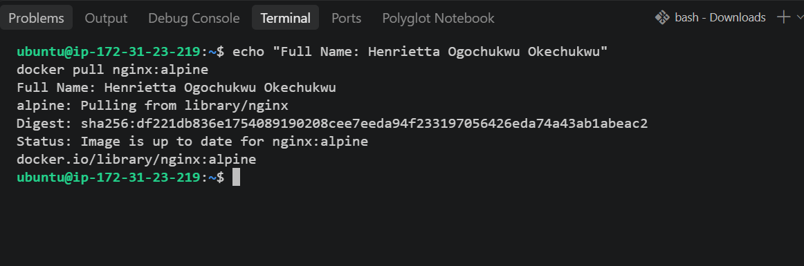

---

#### Screenshot 2 — Host Log Directory

Add a screenshot of the terminal showing the created host directory:

```text
$HOME/nginx-logs
```

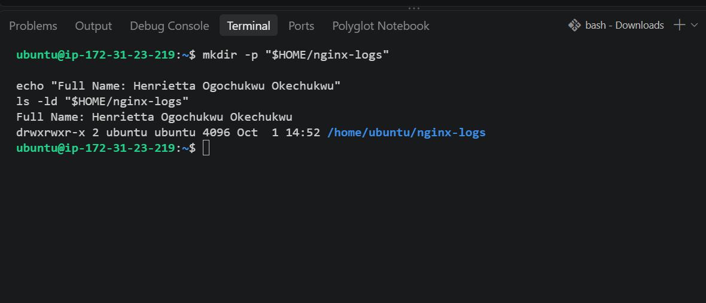

---

#### Screenshot 3 — Running Nginx Container with Port Mapping

Add a screenshot of the terminal showing:

```bash
docker ps
```

The output must show the `myweb` container with:

```text
0.0.0.0:80->80/tcp
```

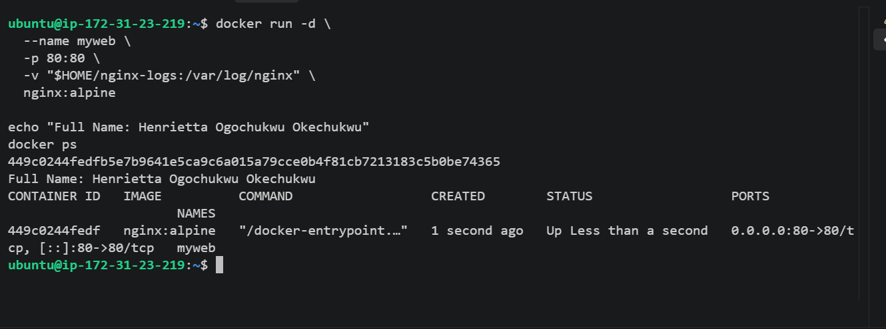

---

#### Screenshot 4 — Nginx Welcome Page

Add a browser screenshot showing the Nginx Welcome Page at:

```text
http://<http://34.207.80.254/>
```

Ensure that the VM public IP is visible in the address bar. Add your full name as a clear caption directly below the screenshot.

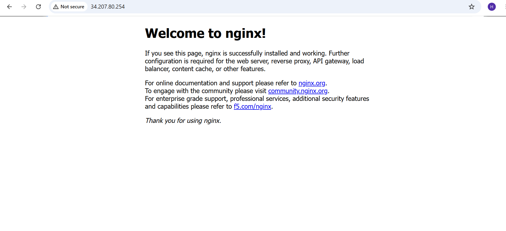

---

#### Screenshot 5 — Bind-Mounted Log Files

Add a screenshot of the terminal showing the host log files and access-log content from:

```text
$HOME/nginx-logs
```

The output must show `access.log`, `error.log`, and an access-log entry created when you opened the Nginx page.

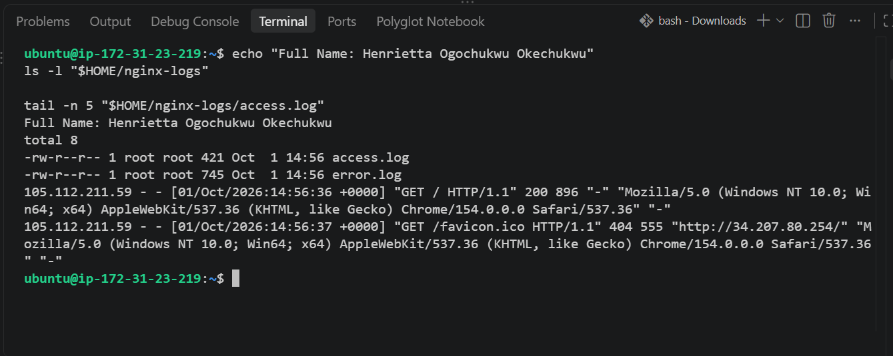

---

#### Screenshot 6 — Nginx Container Removed

Add a screenshot of the terminal showing successful completion of:

```bash
docker stop myweb
docker rm myweb
```

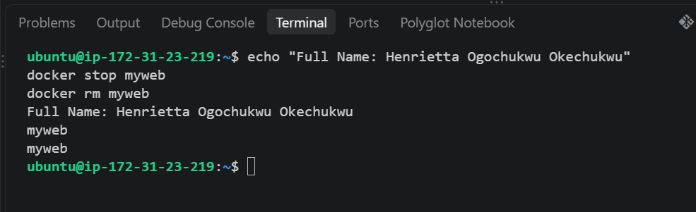

---

#### Screenshot 7 — Logs Persist After Container Removal

Add a screenshot of the terminal showing that `access.log` and `error.log` still exist in:

```text
$HOME/nginx-logs
```

The access log must retain its content after the container has been removed.

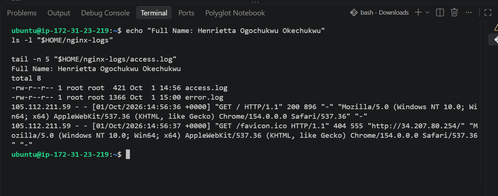

---

# Task 2 — Share Persistent Data Using a Docker Volume

## Goal

Deploy backend and frontend containers that share data through a named Docker Volume. Verify that the data remains after both containers are removed and recreated.

### Evidence

#### Screenshot 8 — Project File Structure

Add a screenshot of the terminal showing the `two-tier-app` project structure, including separate `backend` and `frontend` directories with a `Dockerfile` and `index.js` file in each.

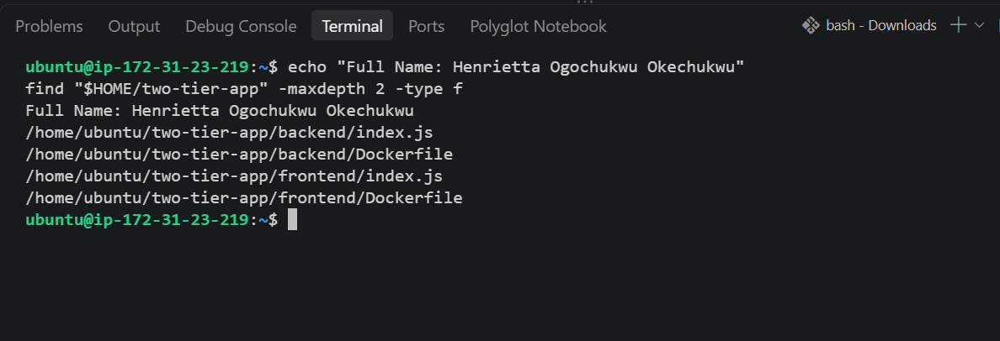

---

#### Screenshot 9 — Custom Docker Network

Add a screenshot of the terminal showing `mynetwork` in:

```bash
docker network ls
```

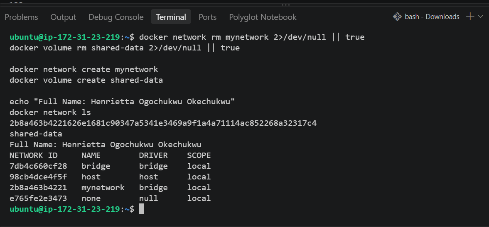

---

#### Screenshot 10 — Docker Volume

Add a screenshot of the terminal showing `shared-data` in:

```bash
docker volume ls
```

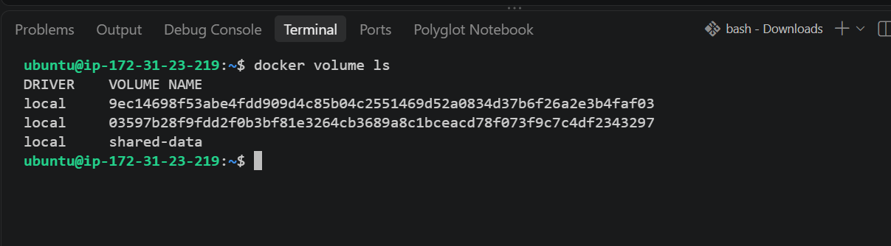

---

#### Screenshot 11 — Backend Dockerfile

Add a screenshot of the terminal showing the completed backend `Dockerfile`.

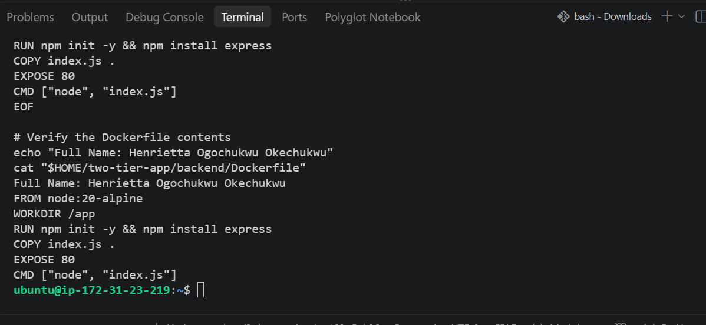

---

#### Screenshot 12 — Backend Image Build

Add a screenshot of the terminal showing successful completion of the `backend-app:latest` image build.

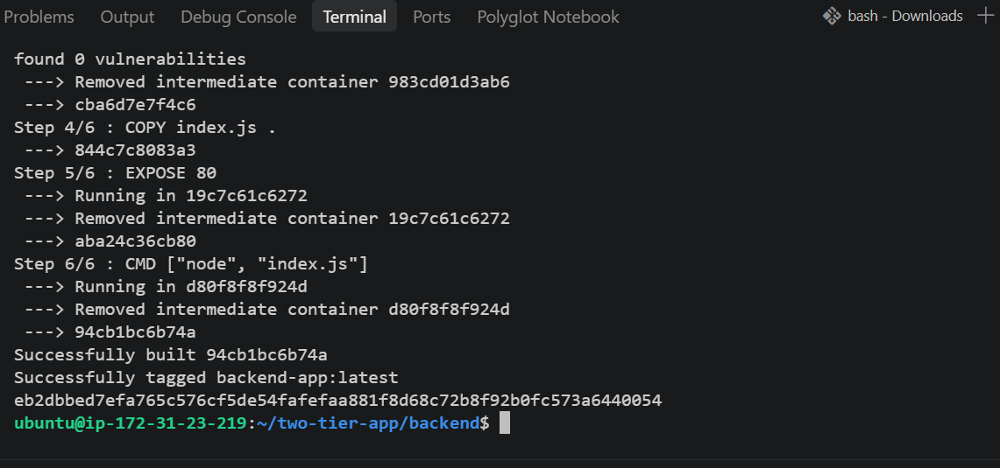

---

#### Screenshot 13 — Running Backend Container

Add a screenshot of the terminal showing:

```bash
docker ps
```

The output must show the running `backend` container.

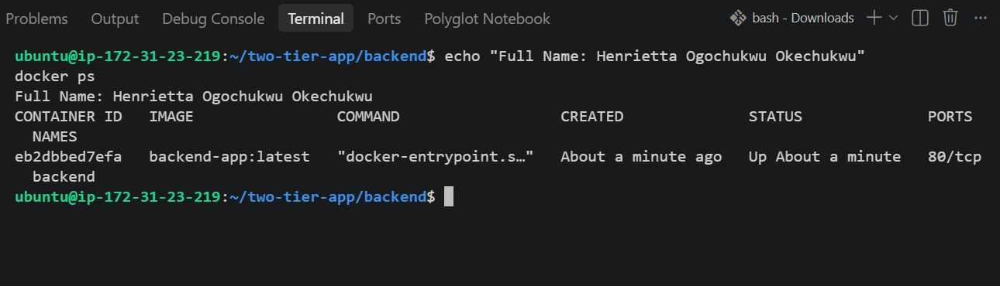

---

#### Screenshot 14 — Frontend Dockerfile

Add a screenshot of the terminal showing the completed frontend `Dockerfile`.

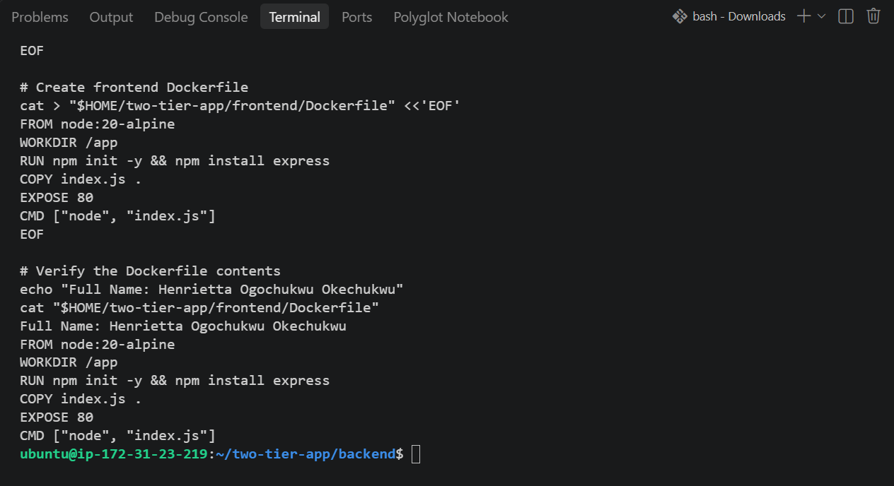

---

#### Screenshot 15 — Frontend Image Build

Add a screenshot of the terminal showing successful completion of the `frontend-app:latest` image build.

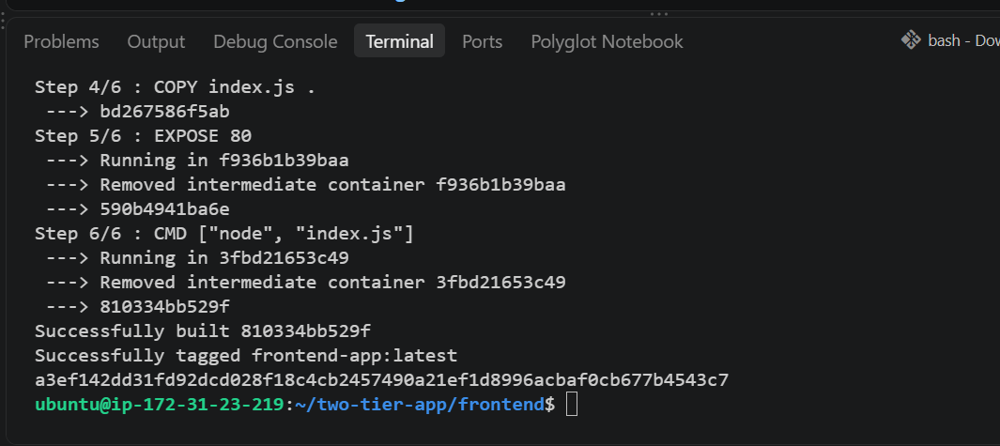

---

#### Screenshot 16 — Running Backend and Frontend Containers

Add a screenshot of the terminal showing:

```bash
docker ps
```

The output must show both `backend` and `frontend` containers running. Only `frontend` must have the published port mapping:

```text
0.0.0.0:80->80/tcp
```

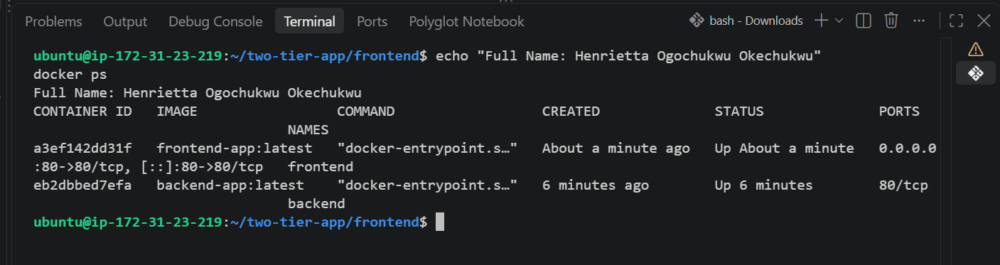

---

#### Screenshot 17 — Backend Write Operation

Add a screenshot of the terminal showing a successful backend write operation to the shared Docker Volume.

The output must include:

```text
Data written: Hello from Backend!
```

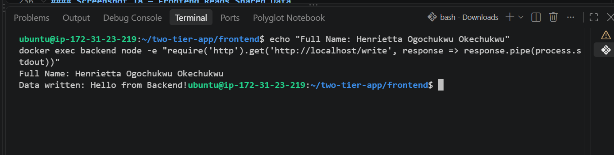

---

#### Screenshot 18 — Frontend Reads Shared Data

Add a browser screenshot showing:

```text
Hello from Backend!
```

Add your full name as a clear caption directly below the screenshot.

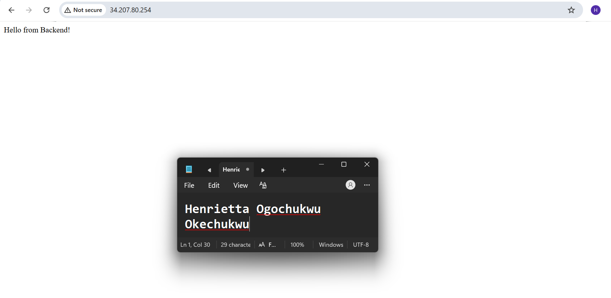

---

#### Screenshot 19 — First Shared-Data Update

Add a browser screenshot showing:

```text
Test Data 1
```

Add your full name as a clear caption directly below the screenshot.

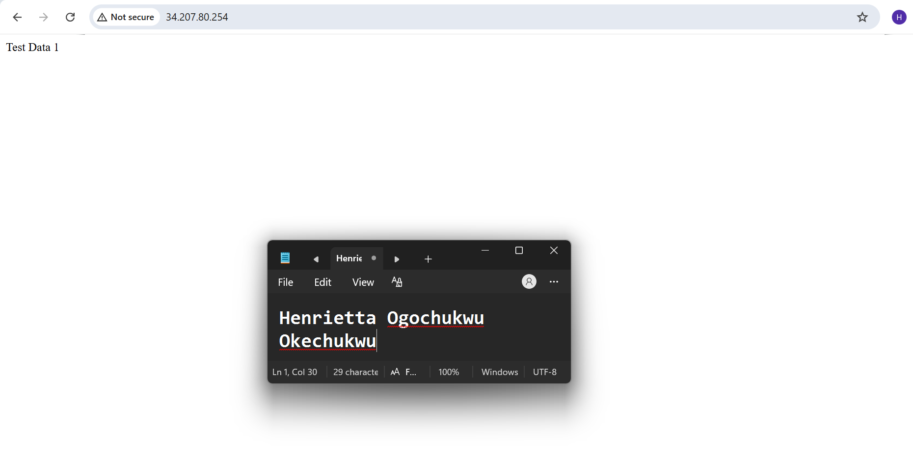

---

#### Screenshot 20 — Second Shared-Data Update

Add a browser screenshot showing:

```text
Test Data 2 - New Update
```

Add your full name as a clear caption directly below the screenshot.

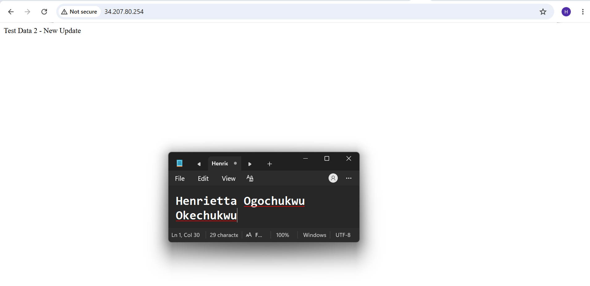

---

#### Screenshot 21 — Container Removal and Recreation

Add a screenshot of the terminal showing the `frontend` and `backend` containers removed and recreated using the same `shared-data` Docker Volume.

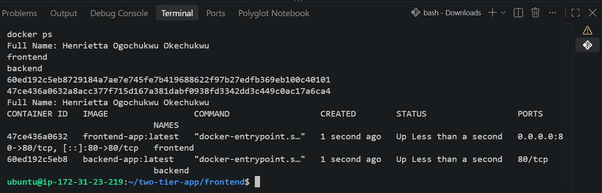

---

#### Screenshot 22 — Data Persists After Recreation

Add a browser screenshot showing:

```text
Test Data 2 - New Update
```

This proves that the `shared-data` Docker Volume outlived both application containers.

Add your full name as a clear caption directly below the screenshot.


---

# Storage Persistence Notes

Write a short explanation covering:

- The difference between a Bind Mount and a Docker Volume
- How Task 1 proved Bind Mount persistence
- How Task 2 proved Docker Volume persistence
- Why Docker Volumes are commonly used for application data

Difference Between a Bind Mount and a Docker Volume:
Bind Mounts: Link a specific, user-defined directory on the host machine’s filesystem (e.g., $HOME/nginx-logs) directly into a container directory. You have total control over the exact host path, making them ideal when host-level file access or direct inspection is required (such as logs or local development code).

Docker Volumes: Managed entirely by Docker and stored within a dedicated area of the host filesystem managed by Docker (/var/lib/docker/volumes/). They are decoupled from the host's directory structure, making them portable, secure, and the preferred standard for production application data.

How Task 1 Proved Bind Mount Persistence:
In Task 1, an Nginx container was deployed with a bind mount linking $HOME/nginx-logs to /var/log/nginx. After browsing the application to generate live traffic, the Nginx container was completely stopped and removed (docker rm myweb). Checking the host directory afterwards confirmed that access.log and error.log remained fully intact on the EC2 host, proving that bind mounts allow data to survive container deletion.

How Task 2 Proved Docker Volume Persistence:
In Task 2, a two-tier Node.js application used a shared Docker Volume (shared-data). The backend container wrote dynamic updates (Test Data 2 - New Update) to the volume, and the frontend read them. After completely removing both the backend and frontend containers, they were recreated from scratch using the same volume. When the application URL was accessed, the browser still displayed Test Data 2 - New Update, proving that Docker Volumes outlive container lifecycles.

Why Docker Volumes Are Commonly Used for Application Data:
Docker Volumes are the preferred mechanism for persisting data in production because they are managed entirely by Docker, isolate storage from container lifecycles, and can be safely shared across multiple containers simultaneously. This ensures that stateful services (like databases and file uploads) are protected during container upgrades, scaling, or replacements.

---

# Public Application URL

**Application URL:** `http://34.207.80.254/`

---

# LinkedIn Requirement

## Goal

Create a LinkedIn post about Docker Volumes and Bind Mounts, including one difference between them, how you verified persistent storage, and your key learning outcomes.

### Evidence

#### LinkedIn Post URL

Paste your LinkedIn post URL here:

`https://lnkd.in/p/d-jcGDqk`

---

#### LinkedIn Post Screenshot

Add a screenshot of the published LinkedIn post here. Include a screenshot of the application displaying shared data.

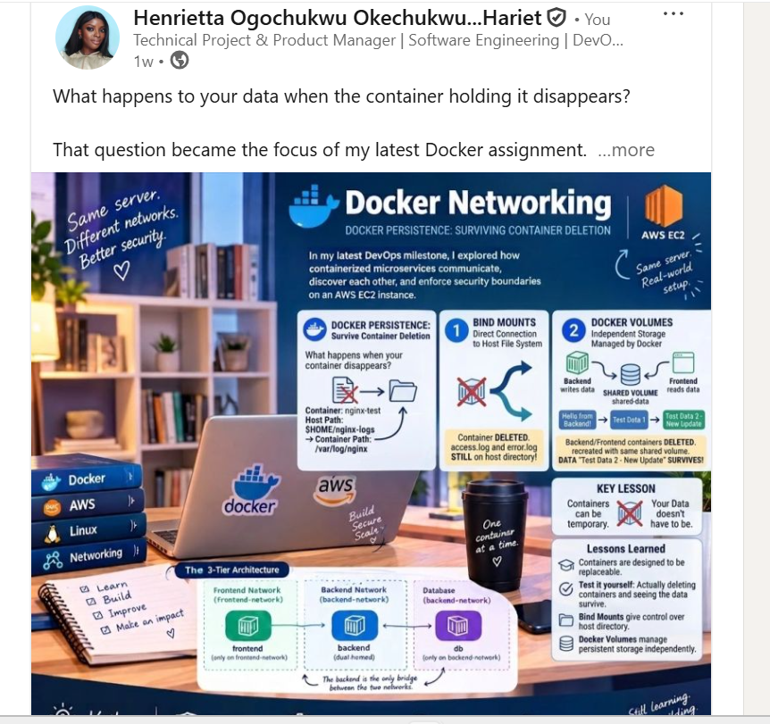

---

# Submission Instructions

- Complete all tasks in sequence.
- Include Screenshots 1–22 exactly as specified.
- Include the Storage Persistence Notes section.
- Include the public application URL.
- Include the LinkedIn post URL and screenshot.
- Ensure that your full name is visible in all terminal screenshots.
- Add your full name as a clear caption below every browser screenshot.
- Do not expose private keys, passwords, access keys, tokens, account IDs, or other sensitive information.

---

# Completion Checklist

- [ ] Nginx image pulled successfully
- [ ] Host log directory created
- [ ] Bind Mount configured successfully
- [ ] Nginx logs remain after container removal
- [ ] Custom Docker network created
- [ ] Docker Volume created
- [ ] Backend Dockerfile and image created
- [ ] Frontend Dockerfile and image created
- [ ] Both containers mount `shared-data`
- [ ] Backend writes data to the Docker Volume
- [ ] Frontend reads the same data from the Docker Volume
- [ ] Updated data appears after browser refresh
- [ ] Data remains after frontend and backend containers are removed and recreated
- [ ] All required screenshots included
- [ ] Storage Persistence Notes completed
- [ ] Public application URL included
- [ ] LinkedIn post URL and screenshot included
- [ ] Full name visible in terminal screenshots
- [ ] Browser screenshots have full-name captions
- [ ] No sensitive information exposed

---

## 📌 About DMI & CloudAdvisory

DevOps Micro Internship (DMI) is a project-based DevOps program run by Pravin Mishra (The CloudAdvisory) focused on real-world execution, systems thinking, and career readiness.

It helps learners build strong DevOps foundations with hands-on experience.

---

## 📌 Resources

- 🌐 DMI Official Website: https://dmi.pravinmishra.com?utm_source=github&utm_medium=readme  
- 🎓 University: https://university.pravinmishra.com?utm_source=github&utm_medium=readme  
- 💬 Discord Community: https://discord.pravinmishra.com?utm_source=github&utm_medium=readme  
- 📝 Blog: https://dmi.pravinmishra.com/blog?utm_source=github&utm_medium=readme  
- ▶️ YouTube Playlist: https://www.youtube.com/playlist?list=PLFeSNDtI4Cho  
- 🔗 Pravin Mishra (LinkedIn): https://www.linkedin.com/in/pravin-mishra-aws-trainer/  
- 🏢 CloudAdvisory (LinkedIn): https://www.linkedin.com/company/thecloudadvisory/

---

*This submission is part of DevOps Micro Internship (DMI) — Agentic AI Track.*
