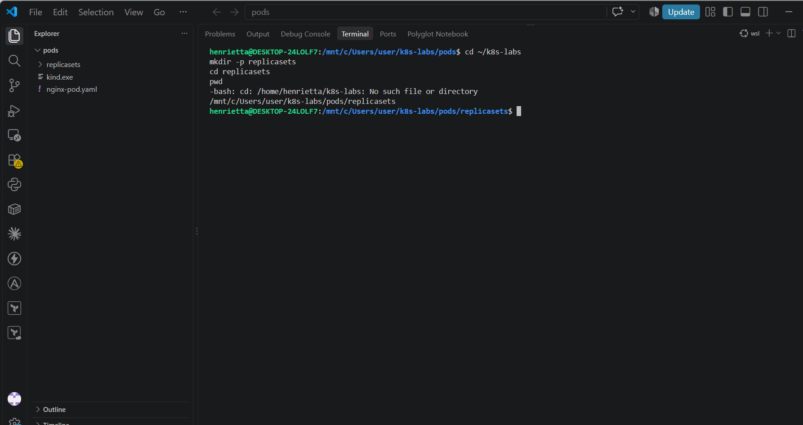
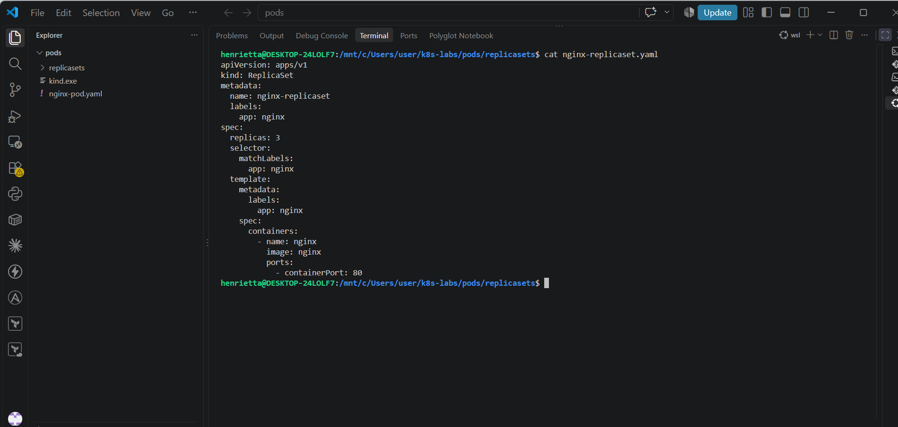
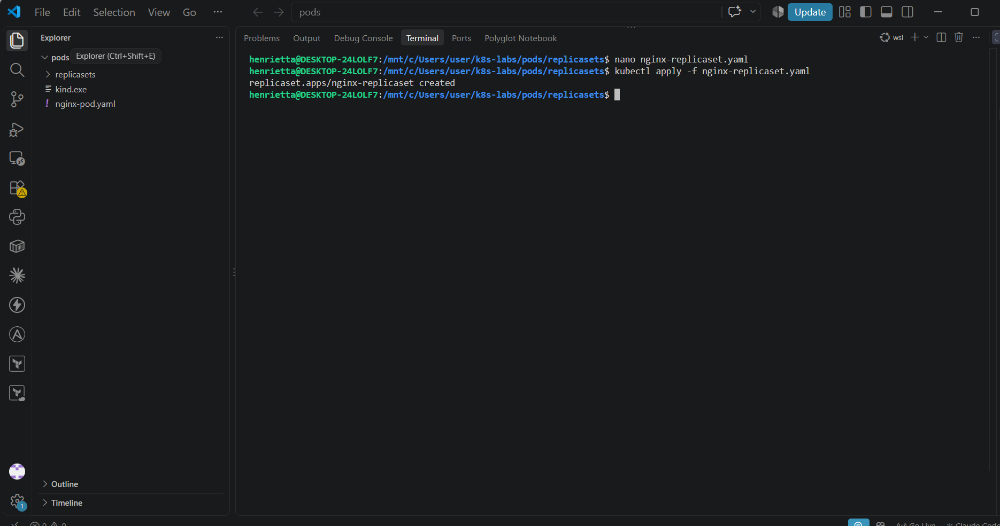
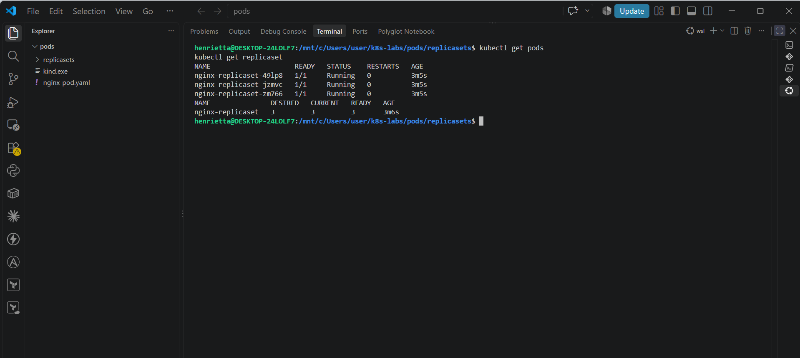
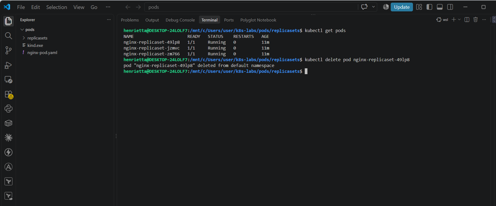
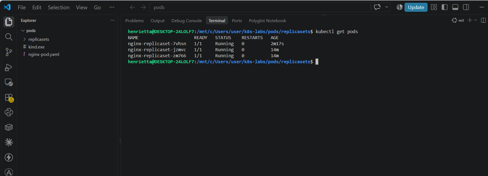
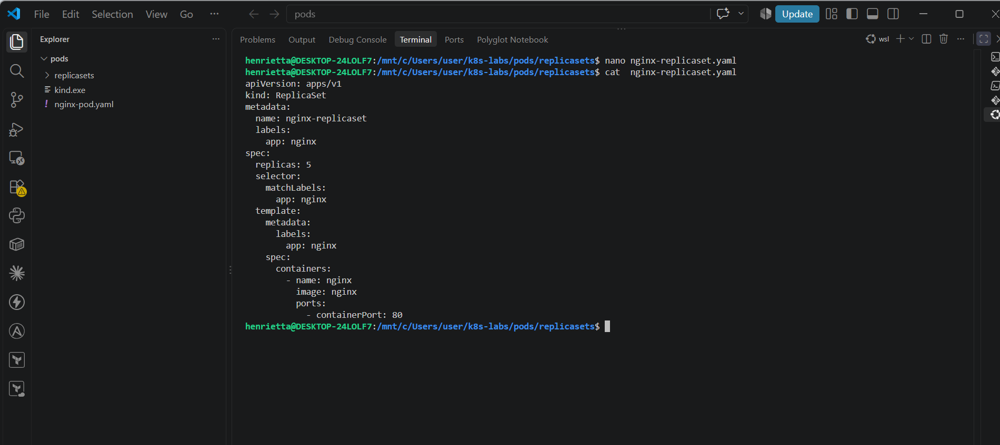
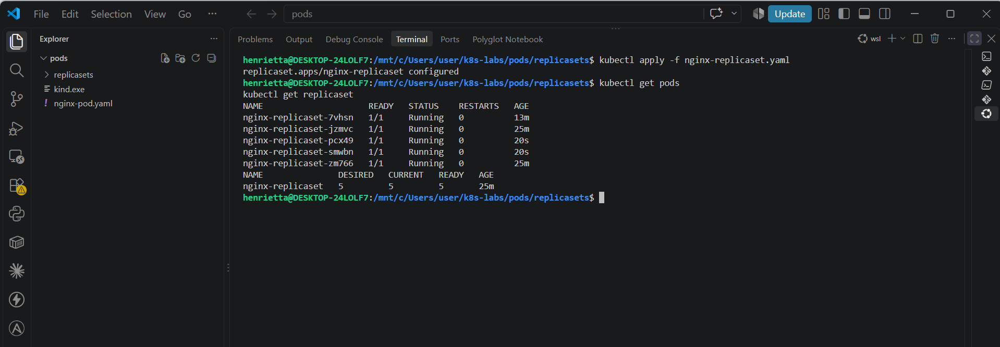
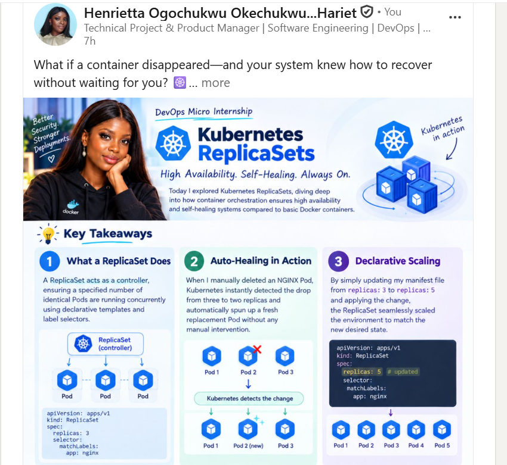

# Assignment 02 — ReplicaSets: Keeping Your Pods Alive

Part of the DevOps Micro Internship (DMI) with Agentic AI

---

## Purpose

In this assignment, you will create three NGINX Pods using a ReplicaSet, test auto-healing by deleting one Pod, and scale the ReplicaSet from three to five Pods.

---

# Task 0 — Pre-check: Remove the Pod from Assignment 01

## Goal

Confirm that you are connected to your learning cluster and remove the previous standalone Pod to prevent the ReplicaSet from adopting it.

### Evidence

No screenshots required.

---

# Task 1 — Set Up Your Working Directory

## Goal

Create and enter a dedicated directory for this ReplicaSet lab.

### Evidence

#### Screenshot 01 — Output of `pwd` showing the working directory ending in `/k8s-labs/replicasets`

---

### Notes

**1. Why is it useful to keep Kubernetes manifests in organized directories?**

1. Keeping manifests organized in dedicated directories (such as ~/k8s-labs/replicasets) makes it easy to locate, manage, and version-control configuration files for specific resources or labs. It prevents clutter, avoids naming conflicts, and ensures you apply the correct declarative files to your cluster.
---

**2. What file will you create in this directory for this assignment?**

You will create the nginx-replicaset.yaml manifest file to define and manage the NGINX ReplicaSet.

---

# Task 2 — Create and Apply the NGINX ReplicaSet

## Goal

Create a ReplicaSet that maintains three NGINX Pods.

### Evidence

#### Screenshot 02 — Completed `nginx-replicaset.yaml` manifest showing `replicas: 3`

---

#### Screenshot 03 — Output of `kubectl apply -f nginx-replicaset.yaml`

---

#### Screenshot 04 — Output of `kubectl get pods` showing three NGINX Pods with `1/1` under `READY` and `Running` under `STATUS`

---

### Notes

**1. What does `replicas: 3` mean in this manifest?**

replicas: 3 specifies the desired state for the ReplicaSet, instructing Kubernetes to maintain exactly three identical Pods running concurrently in the cluster at all times.

---

**2. Why must `selector.matchLabels` match `template.metadata.labels`?**

They must match because the ReplicaSet uses selector.matchLabels to identify which existing Pods belong to it, while template.metadata.labels assigns that exact label to every new Pod created from the template. If they do not match, the ReplicaSet will fail validation or fail to recognize and manage its pods.

---

**3. What image and image tag are used for the NGINX container?**

The nginx image is used with the default latest tag (or whichever tag you pinned, such as nginx:latest).

---

# Task 3 — Test ReplicaSet Auto-Healing

## Goal

Delete one Pod managed by the ReplicaSet and observe Kubernetes automatically create a replacement.

### Evidence

#### Screenshot 05 — Output of the command deleting one ReplicaSet-managed Pod

---

#### Screenshot 06 — Output of `kubectl get pods` showing the replacement Pod with a different name from the deleted Pod

---

#### Screenshot 07 — Output showing three NGINX Pods with `1/1` under `READY` and `Running` under `STATUS` again

---

### Notes

**1. What happened after you deleted one Pod?**
The target Pod was terminated, reducing the active count to two. However, Kubernetes immediately detected the difference and automatically created a brand-new replacement Pod to restore the desired state.

---

**2. How does the ReplicaSet know that a replacement Pod is needed?**
The ReplicaSet controller continuously compares the desired replica count (replicas: 3) with the actual number of running Pods matching its label selector (app=nginx). When a Pod is deleted, the count drops below 3, triggering the controller to spin up a replacement.

---

**3. What proves that auto-healing worked successfully?**
Running kubectl get pods showed that the total running count returned to three, with the new replacement Pod displaying a very young age compared to the surviving older Pods.

---

# Task 4 — Manually Scale the ReplicaSet

## Goal

Scale the ReplicaSet from three NGINX Pods to five NGINX Pods by changing the YAML manifest.

### Evidence

#### Screenshot 08 — Updated `nginx-replicaset.yaml` showing `replicas: 5`

---

#### Screenshot 09 — Output of `kubectl get pods` showing five NGINX Pods with `1/1` under `READY` and `Running` under `STATUS`

---

### Notes

**1. What change did you make to scale the ReplicaSet?**

I updated the replicas field in nginx-replicaset.yaml from 3 to 5 and reapplied the manifest using kubectl apply.

---

**2. Did you manually create the additional Pods? Explain why or why not.**

No, I did not manually create them. The ReplicaSet controller automatically detected the new desired state and created the two additional Pods from the template.

---

**3. What would happen if you changed the replica count from five back to three?**

Kubernetes would automatically terminate two of the running Pods until the active count matched the desired state of three.

---

# LinkedIn Requirement

Create a LinkedIn post that includes:

- A short explanation of what a Kubernetes ReplicaSet does.
- What happened when you deleted one NGINX Pod.
- How Kubernetes automatically created a replacement Pod to maintain the desired replica count.
- What you learned by changing the replica count from three to five.
- One screenshot showing either:
  - Three Pods running after the auto-healing test, or
  - Five Pods running after scaling the ReplicaSet.

Do not share sensitive information, cluster credentials, tokens, or kubeconfig details in your post.

### Evidence

#### Screenshot 10 — Published LinkedIn post showing your name, the required explanation, and the attached Pod screenshot

---

### Post Link

https://lnkd.in/p/d-kpRGQP

---

# Submission Instructions

- Add all required screenshots, numbered 01–10, to this template.
- Full Name must be visible in required screenshots.
- Ensure screenshots are clear and readable.
- Submit the final `nginx-replicaset.yaml` file showing `replicas: 5`. Screenshot 02 provides evidence of the initial manifest with `replicas: 3`.
- Complete the Notes sections in Tasks 1–4 in your own words.
- Include the published LinkedIn post URL.
- Do not expose tokens, passwords, private keys, kubeconfig files, or account IDs.

---

# Completion Checklist

- [ ] Completed Task 0 and confirmed that the previous `nginx-pod` is no longer listed
- [ ] Created and entered the ReplicaSet working directory (Screenshot 01)
- [ ] Created `nginx-replicaset.yaml` with an initial replica count of three (Screenshot 02)
- [ ] Applied the ReplicaSet manifest successfully (Screenshot 03)
- [ ] Confirmed three NGINX Pods are running (Screenshot 04)
- [ ] Deleted one ReplicaSet-managed Pod (Screenshot 05)
- [ ] Observed the automatically created replacement Pod (Screenshot 06)
- [ ] Confirmed three NGINX Pods are running again (Screenshot 07)
- [ ] Changed the replica count from three to five (Screenshot 08)
- [ ] Confirmed five NGINX Pods are running (Screenshot 09)
- [ ] Submitted the final `nginx-replicaset.yaml` file with `replicas: 5`
- [ ] Completed the Notes sections in Tasks 1–4
- [ ] Published the LinkedIn post with the required explanation and Pod screenshot (Screenshot 10)
- [ ] Included the published LinkedIn post URL
- [ ] Included all required screenshots
- [ ] No sensitive data exposed

---

## 📌 About DMI & CloudAdvisory

DevOps Micro Internship (DMI) is a project-based DevOps program run by Pravin Mishra (The CloudAdvisory) focused on real-world execution, systems thinking, and career readiness.

It helps learners build strong DevOps foundations with hands-on experience.

---

## 📌 Resources

- 🌐 DMI Official Website: https://dmi.pravinmishra.com?utm_source=github&utm_medium=readme  
- 🎓 University: https://university.pravinmishra.com?utm_source=github&utm_medium=readme  
- 💬 Discord Community: https://discord.pravinmishra.com?utm_source=github&utm_medium=readme  
- 📝 Blog: https://dmi.pravinmishra.com/blog?utm_source=github&utm_medium=readme  
- ▶️ YouTube Playlist: https://www.youtube.com/playlist?list=PLFeSNDtI4Cho  
- 🔗 Pravin Mishra (LinkedIn): https://www.linkedin.com/in/pravin-mishra-aws-trainer/  
- 🏢 CloudAdvisory (LinkedIn): https://www.linkedin.com/company/thecloudadvisory/

---

*This submission is part of DevOps Micro Internship (DMI) — Agentic AI Track.*
