# Assignment 4 — Auto-Scaling & Auto-Healing: Let Kubernetes React for You

Part of the DevOps Micro Internship (DMI) with Agentic AI

---

## Purpose

Create Deployments, test Pod auto-healing, configure CPU requests and limits, verify Metrics Server, and create a Horizontal Pod Autoscaler.

Optionally generate CPU load to observe how the HPA responds.

---

# Task 0 — Check the Existing Cluster Resources

## Goal

Confirm that you are connected to your learning cluster and inspect existing Deployments and HPAs.

### Evidence

No screenshots required.

---

# Task 1 — Set Up Your Lab Directory

## Goal

Create and enter a dedicated directory for the auto-scaling lab.

### Evidence

#### Screenshot 1 — Terminal showing that you are working inside `~/k8s-labs/autoscaling`

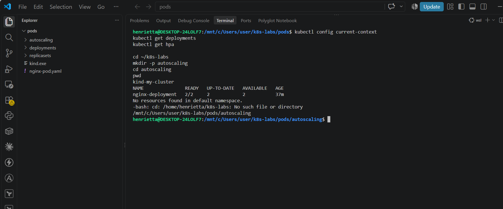

---

### Notes

**1. What is the difference between auto-healing and auto-scaling?**

Auto-healing ensures that the actual number of running Pods matches the desired replica count by replacing failed or deleted Pods. Auto-scaling dynamically changes the desired replica count itself in response to changing workloads and resource utilization (such as CPU load).

---

**2. Which Kubernetes feature will you use for CPU-based auto-scaling?**

The Horizontal Pod Autoscaler (HPA).

---

# Task 2 — Test Auto-Healing with a Deployment

## Goal

Create a Deployment with two replicas, delete one Pod, and observe Kubernetes create a replacement Pod.

### Evidence

#### Screenshot 2 — Completed `autohealing-deployment.yaml` manifest

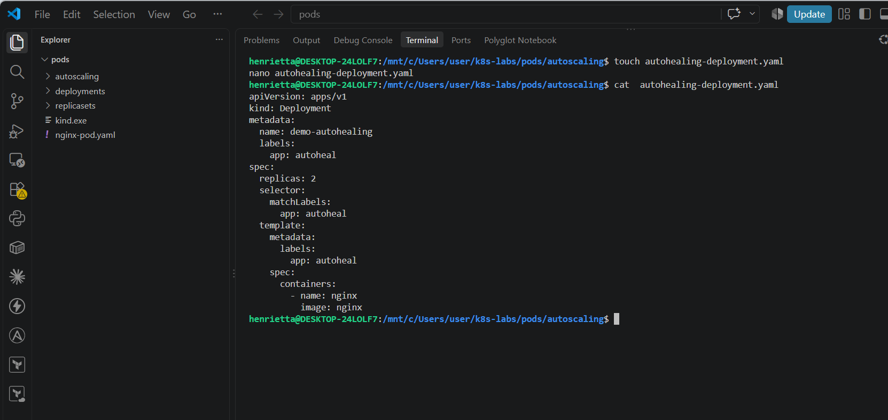

---

#### Screenshot 3 — Output of `kubectl get pods` showing two running Pods before deletion

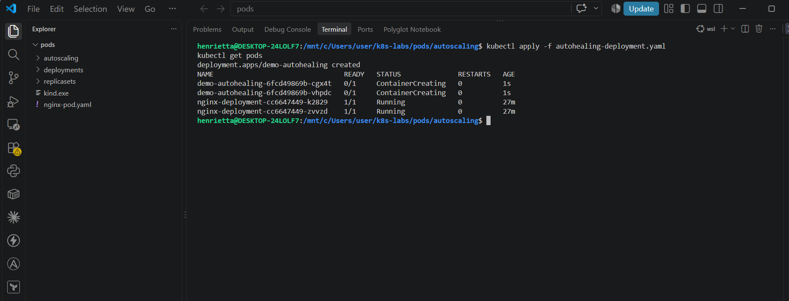

---

#### Screenshot 4 — Output of the `kubectl delete pod` command

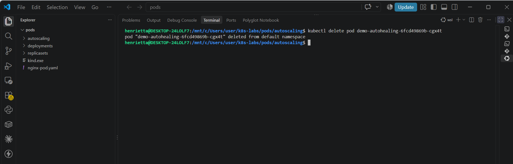

---

#### Screenshot 5 — Output of `kubectl get pods` showing the replacement Pod and two running Pods

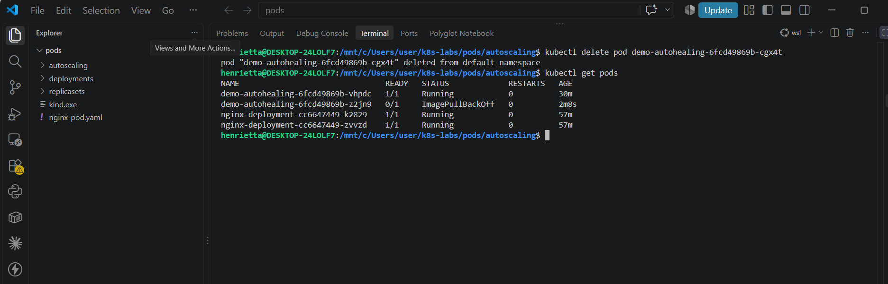

---

### Notes

**1. What happened after you deleted one Pod?**

The deleted pod was terminated, but Kubernetes immediately detected the drop in replica count and automatically spun up a brand-new replacement pod

---

**2. What Kubernetes resource maintains the desired replica count for this Deployment?**

The ReplicaSet created and managed by the Deployment.

---

**3. What proves that auto-healing worked?**

The active pod count returned to two, and the new replacement pod displayed a very young age compared to the surviving older pod.

---

# Task 3 — Create a Deployment for HPA

## Goal

Create a Deployment with CPU resource requests and limits so that HPA can calculate CPU utilization.

### Evidence

#### Screenshot 6 — Completed `hpa-deployment.yaml` manifest showing CPU requests and limits

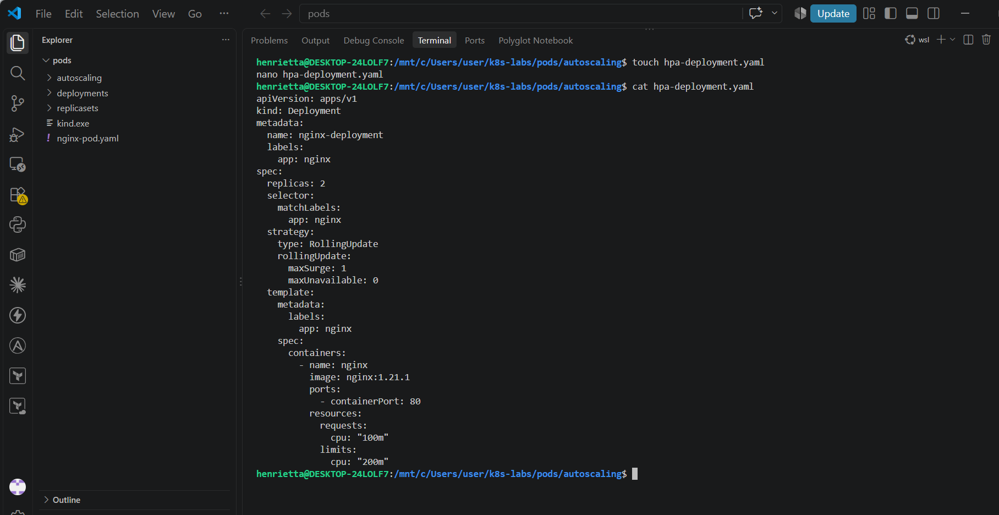

---

#### Screenshot 7 — Output showing `nginx-deployment` and its running Pods

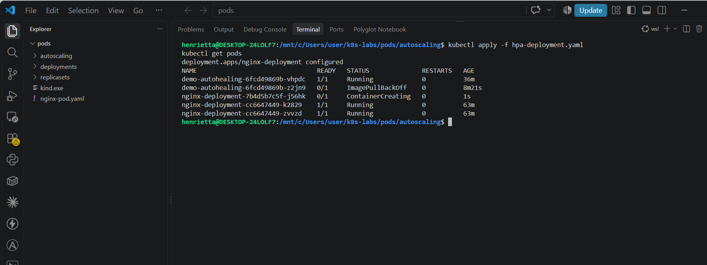

---

### Notes

**1. What does `cpu: "100m"` mean?**

It represents a CPU request of 100 millicores (0.1 of a CPU core), serving as the baseline for scheduling and HPA utilization calculations.

---

**2. What is the difference between a CPU request and a CPU limit?**

A CPU request is the guaranteed minimum resource allocated to the container, whereas a CPU limit is the maximum ceiling of CPU resources the container is allowed to consume.

---

**3. Why does CPU-based HPA require CPU requests?**

HPA calculates CPU utilization percentage relative to the defined CPU request (e.g., current usage divided by the requested amount).

---

# Task 4 — Enable and Verify Metrics Server

## Goal

Ensure the cluster can collect resource metrics for the HPA.

### Evidence

#### Screenshot 8 — Output showing Metrics Server running, or `kubectl top pods` displaying Pod metrics

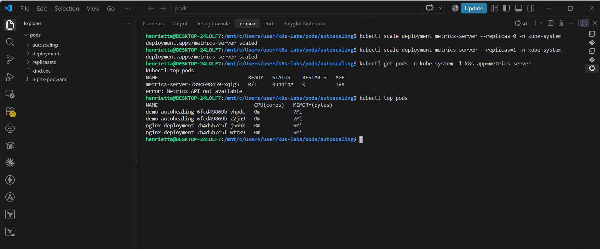

---

### Notes

**1. Why does HPA need Metrics Server?**

To collect real-time CPU and memory usage metrics from nodes and pods, which HPA evaluates against its scaling targets.

---

**2. What issue can occur if Metrics Server is not working?**

HPA will fail to fetch resource metrics, resulting in <unknown> utilization targets and an inability to make scaling decisions.

---

**3. What does `kubectl top pods` help you check?**

It displays the current actual CPU and memory consumption of running pods

---

# Task 5 — Create a Horizontal Pod Autoscaler

## Goal

Create an HPA that keeps at least two Pods running and can scale up to five Pods when average CPU utilization exceeds 50%.

### Evidence

#### Screenshot 9 — The imperative command output OR completed `hpa-nginx.yaml` manifest

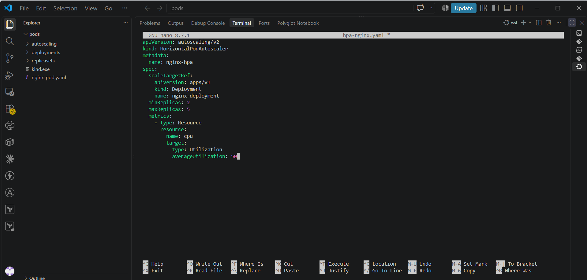

---

#### Screenshot 10 — Output of `kubectl get hpa` and the relevant `kubectl describe hpa` command

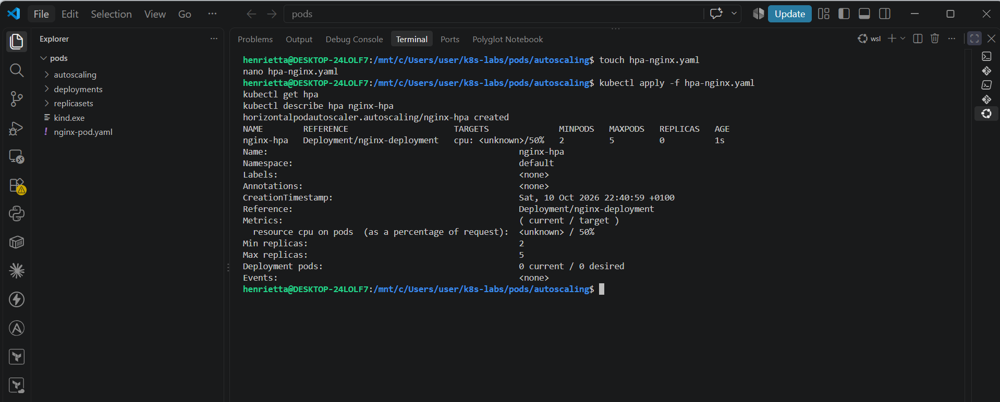

---

### Notes

**1. What does `minReplicas: 2` mean?**

It sets the lower limit for the number of replicas the HPA can scale down to.

---

**2. What does `maxReplicas: 5` mean?**

It sets the upper limit for the number of replicas the HPA can scale up to.

---

**3. What does `averageUtilization: 50` mean?**

It instructs the HPA to maintain an average CPU utilization of 50% across all pods controlled by the deployment.

---

**4. Why should only one HPA manage a Deployment at a time?**

Multiple HPAs targeting the same resource would send conflicting scaling instructions, resulting in constant thrashing and unpredictable replica counts.

---

# Task 6 — Optional: Generate CPU Load and Observe Scaling

## Goal

Generate CPU load in one NGINX Pod and observe how HPA responds.

### Evidence

If you skip this task, write “Not completed — optional” and leave the remaining Task 6 placeholders blank.

Task status: Completed

#### Screenshot 11 — Terminal showing the CPU-load command running inside the selected Pod

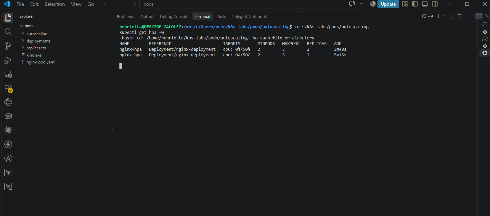
---

#### Screenshot 12 — Output of `kubectl get hpa` and `kubectl get pods` while HPA evaluates or changes the replica count

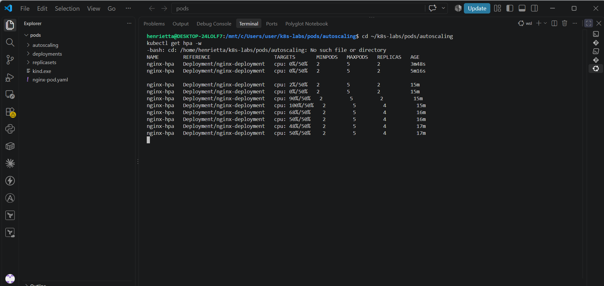

---

### Notes

Complete these answers only if you perform the optional test.

**1. Did the HPA change the number of Pods? Explain what you observed.**

Yes. When CPU load was generated inside the NGINX pod, the HPA detected utilization exceeding the 50% target (reaching 100%) and automatically scaled the deployment replicas up from 2 to 4.
---

**2. If scaling did not happen, what are two possible reasons?**

Insufficient CPU request definitions on the deployment containers, or Metrics Server failing to provide resource metrics.

---

**3. Why is automatic scale-down useful after traffic decreases?**

It optimizes resource utilization and reduces infrastructure costs by releasing unneeded compute capacity when traffic subsides.

---

# LinkedIn Requirement

### Evidence

#### Screenshot 13 — Published LinkedIn post showing your name, the required explanation, and the attached Kubernetes screenshot

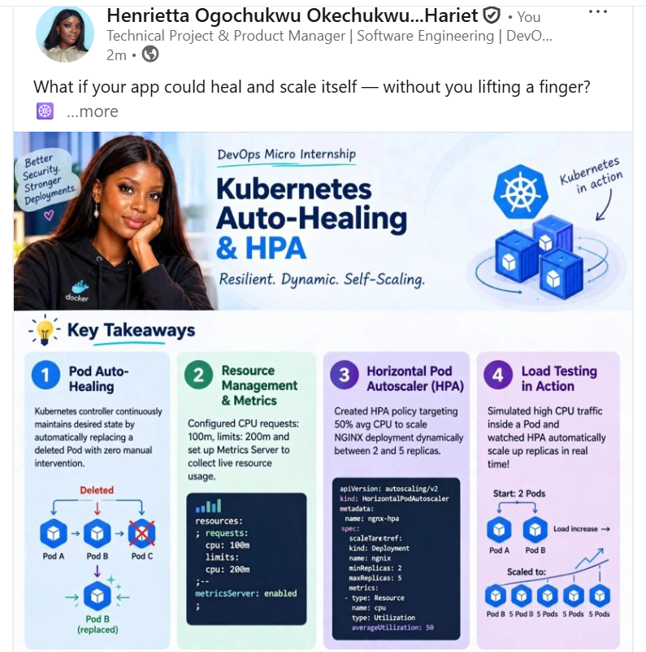

#### Linkedin Post Link

https://www.linkedin.com/posts/henrietta-ogochukwu-onyeabor_devops-kubernetes-cloudcomputing-activity-7516381184004853761-cfB4?utm_source=share&utm_medium=member_desktop&rcm=ACoAACLZGVcB6FzOlcovzi-lUsceaYDsGRsJUSU

---

# Submission Instructions

- Include required Screenshots 1–10 and Screenshot 13.
- Include Screenshots 11–12 only if you complete Task 6.
- Full Name must be visible in required screenshots.
- Ensure screenshots are clear and readable.
- Include the completed `autohealing-deployment.yaml` and `hpa-deployment.yaml` files.
- Include `hpa-nginx.yaml` if you selected the declarative HPA method.
- Complete the Notes sections for Tasks 1–5 in your own words.
- Complete Task 6 notes only if you perform the optional test.
- Do not expose passwords, tokens, private keys, kubeconfig files, or account IDs.

---

# Completion Checklist

- [ ] Checked the active context and existing cluster resources
- [ ] Created the autoscaling working directory (Screenshot 1)
- [ ] Created `autohealing-deployment.yaml` (Screenshot 2)
- [ ] Confirmed two auto-healing Pods were running (Screenshot 3)
- [ ] Deleted one managed Pod (Screenshot 4)
- [ ] Confirmed that the Pod was automatically replaced (Screenshot 5)
- [ ] Created `hpa-deployment.yaml` with CPU requests and limits (Screenshot 6)
- [ ] Verified `nginx-deployment` and its running Pods (Screenshot 7)
- [ ] Verified Metrics Server and confirmed Pod metrics are available (Screenshot 8)
- [ ] Created one HPA using the selected method (Screenshot 9)
- [ ] Verified minimum replicas of 2, maximum replicas of 5, and a CPU target of 50% (Screenshot 10)
- [ ] Completed Notes for Tasks 1–5
- [ ] Completed Task 6 evidence and notes, or marked it “Not completed — optional”
- [ ] Stopped the CPU-load command and exited the container shell, if Task 6 was completed
- [ ] Published the LinkedIn post with the required explanation and attached screenshot (Screenshot 13)
- [ ] Included the required manifest files
- [ ] No sensitive data exposed

---

## 📌 About DMI & CloudAdvisory

DevOps Micro Internship (DMI) is a project-based DevOps program run by Pravin Mishra (The CloudAdvisory) focused on real-world execution, systems thinking, and career readiness.

It helps learners build strong DevOps foundations with hands-on experience.

---

## 📌 Resources

- 🌐 DMI Official Website: https://dmi.pravinmishra.com?utm_source=github&utm_medium=readme  
- 🎓 University: https://university.pravinmishra.com?utm_source=github&utm_medium=readme  
- 💬 Discord Community: https://discord.pravinmishra.com?utm_source=github&utm_medium=readme  
- 📝 Blog: https://dmi.pravinmishra.com/blog?utm_source=github&utm_medium=readme  
- ▶️ YouTube Playlist: https://www.youtube.com/playlist?list=PLFeSNDtI4Cho  
- 🔗 Pravin Mishra (LinkedIn): https://www.linkedin.com/in/pravin-mishra-aws-trainer/  
- 🏢 CloudAdvisory (LinkedIn): https://www.linkedin.com/company/thecloudadvisory/

---

*This submission is part of DevOps Micro Internship (DMI) — Agentic AI Track.*
