# Assignment 6 — Kubernetes Health Probes (Liveness)

Part of the DevOps Micro Internship (DMI) with Agentic AI

---

## Purpose

In this assignment, you will configure and test a Kubernetes liveness probe. You will create a baseline NGINX Deployment, add an HTTP liveness probe, intentionally make it fail, observe container restarts, and restore the working configuration.

---

# Task 0 — Prepare the Lab Environment

## Goal

Confirm that you are connected to your learning cluster and remove the previous HPA and NGINX Deployment before starting this lab.

No screenshot or written notes are required for this pre-check.

---

# Task 1 — Set Up Your Lab Directory

## Goal

Create and enter a dedicated directory for the liveness-probe lab.

### Evidence

#### Screenshot 1 — Terminal showing that you are working inside `~/k8s-labs/health-probes-liveness`

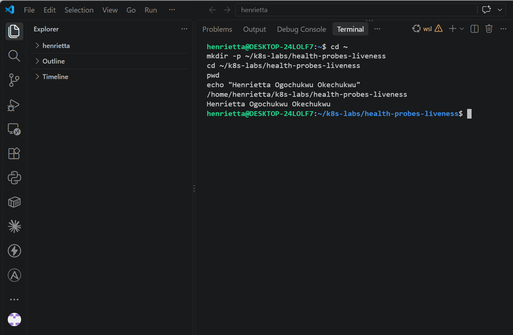

---

### Notes

**1. What problem does a liveness probe solve?**

A liveness probe solves the problem of applications that enter a deadlocked, frozen, or unresponsive state (such as a memory leak or locked thread) where the main process is still technically running. Without a liveness probe, Kubernetes would keep routing traffic or keeping the dead container alive; with a liveness probe, Kubernetes detects the failure and automatically restarts the container to restore service.

**2. What is the key difference between a readiness probe and a liveness probe?**

A readiness probe controls whether a Pod can receive incoming network traffic (if it fails, the Pod's IP is removed from service endpoints without restarting the container). A liveness probe, on the other hand, controls the container's lifecycle (if it fails repeatedly, Kubernetes destroys and restarts the container).

---

# Task 2 — Create a Baseline Deployment Without Probes

## Goal

Create a baseline NGINX Deployment with two replicas and no health probes.

### Evidence

#### Screenshot 2 — Completed `00-nginx-deploy-baseline.yaml` manifest

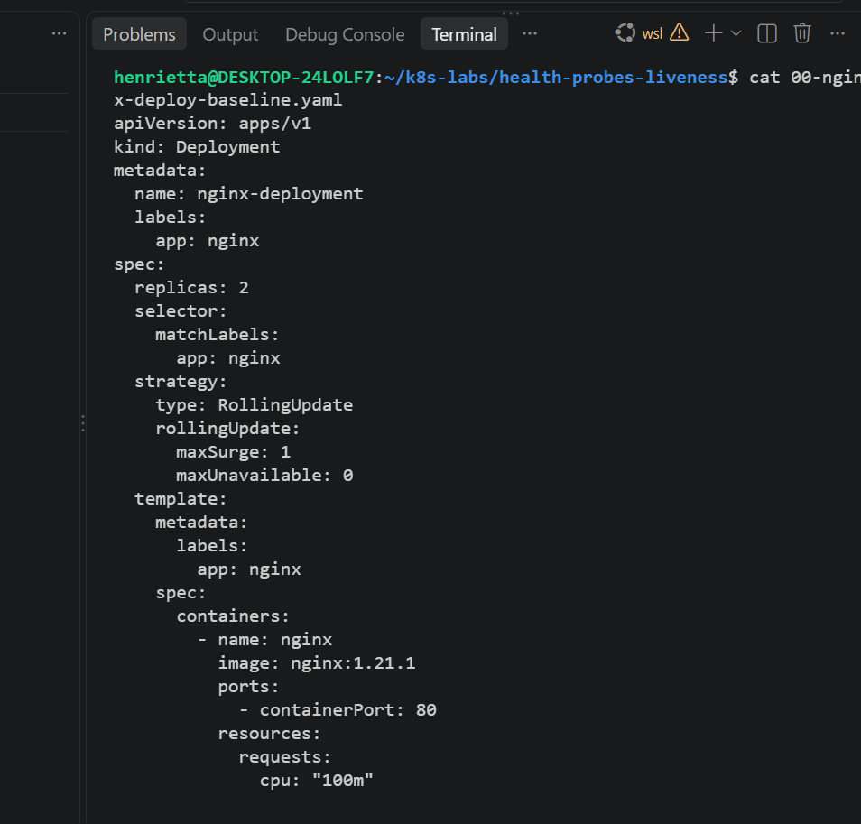

---

#### Screenshot 3 — Output showing a successful rollout and two running NGINX Pods

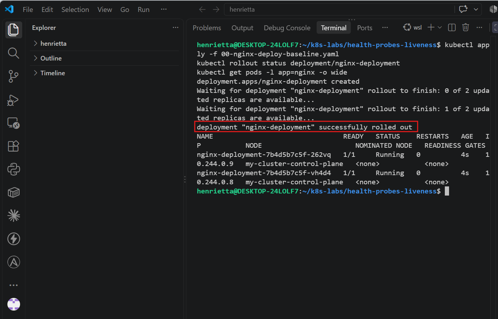

---

#### Screenshot 4 — Relevant output from `kubectl describe deployment nginx-deployment`

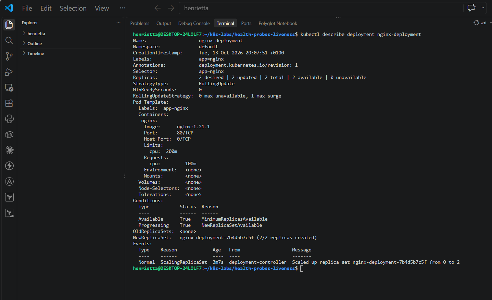

---

### Notes

**1. How many replicas does this Deployment maintain?**

It maintains 2 replicas (replicas: 2), ensuring high availability by running two identical NGINX pod instances simultaneously.

**2. Are any health probes configured in the baseline Deployment?**

No. The baseline Deployment has no health probes configured. The container specification includes only the image name, ports, resource requests, and limits, but no livenessProbe or readinessProbe blocks.

**3. Why is a baseline useful before adding a liveness probe?**

A baseline provides a stable, working comparison point without any health checks. It allows you to verify that your core application and deployment strategy roll out successfully before introducing monitoring probes and failure conditions.

---

# Task 3 — Add a Liveness Probe

## Goal

Add an HTTP liveness probe so Kubernetes can periodically check whether the NGINX container is still responsive.

### Evidence

#### Screenshot 5 — Completed `01-nginx-deploy-liveness.yaml` manifest showing the liveness probe

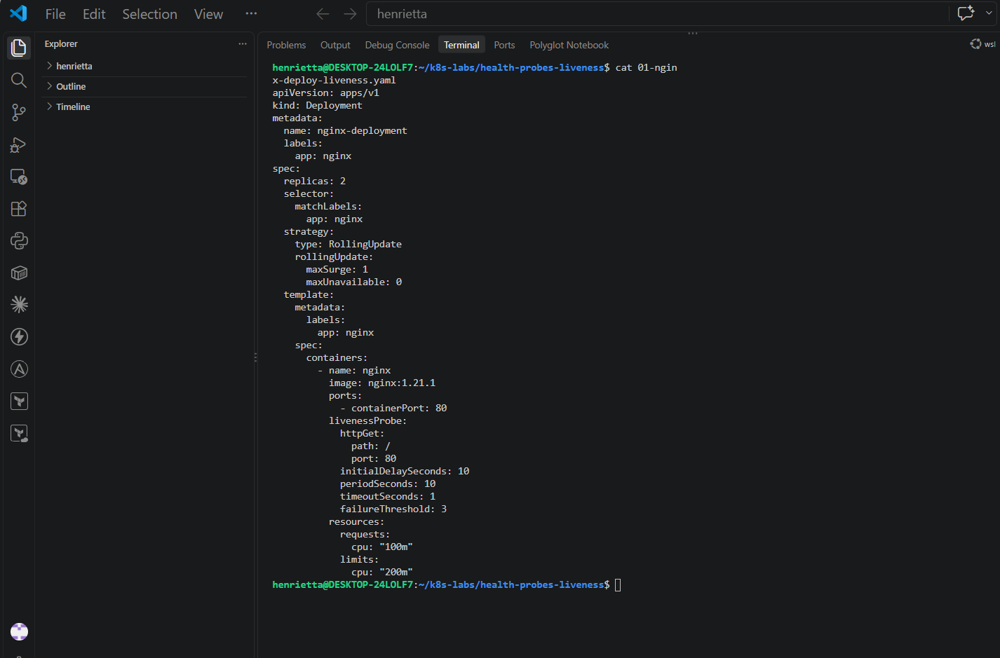

---

#### Screenshot 6 — Output showing successful rollout and running Pods

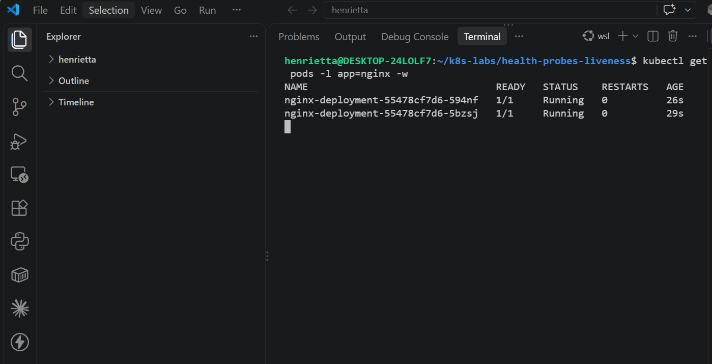

---

#### Screenshot 7 — Pod description showing liveness-probe details

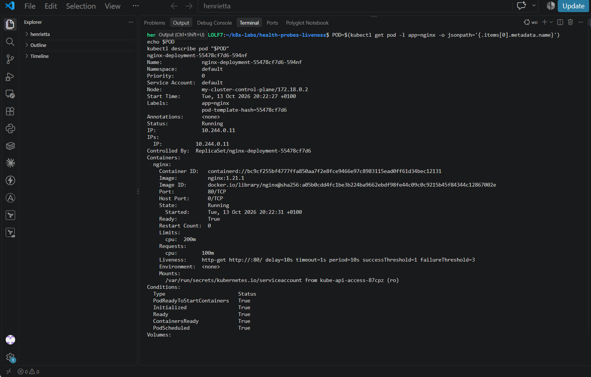
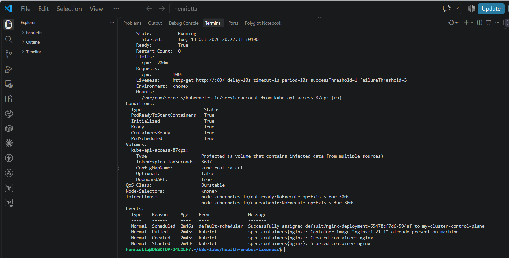

---

### Notes

**1. What path and port does the liveness probe check?**

It checks the root path (/) on port 80

**2. What does `initialDelaySeconds: 10` do?**

It waits for 10 seconds after the container starts before running the first liveness check, giving the NGINX application enough time to initialize properly.

**3. What does `failureThreshold: 3` mean?**

It means Kubernetes will allow up to 3 consecutive failed liveness checks before taking action. After 3 failures in a row, the container is considered unhealthy and will be restarted.

**4. Does a successful liveness probe control whether a Pod receives traffic? Explain briefly.**

No. A liveness probe only determines whether a container needs to be restarted if it becomes unresponsive. Traffic routing and whether a Pod is allowed to receive client requests are handled exclusively by readiness probes.

---

# Task 4 — Trigger and Observe a Liveness Restart

## Goal

Intentionally make the liveness probe fail and observe Kubernetes restart the unhealthy container.

### Evidence

#### Screenshot 8 — `02-nginx-liveness-broken.yaml` showing `/does-not-exist`

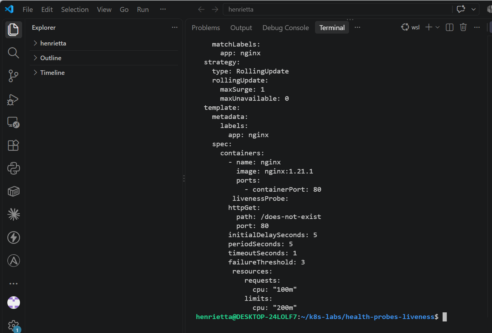

---

#### Screenshot 9 — Pod output showing an increased RESTARTS count

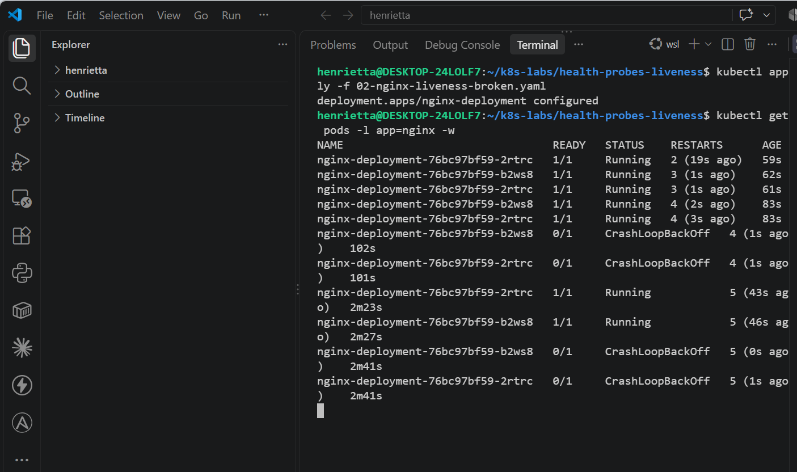

---

#### Screenshot 10 — Pod description showing liveness-probe failure events or restart details

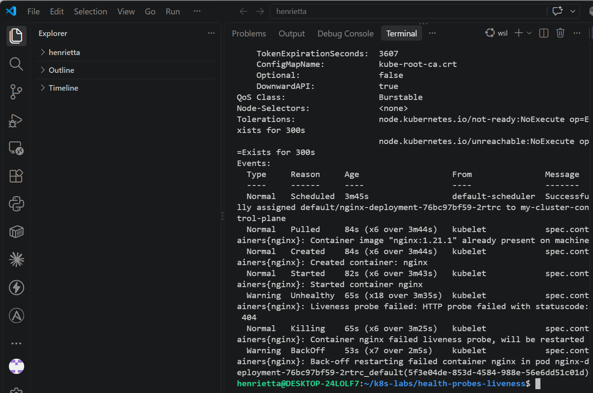

---

#### Screenshot 11 — Output showing stable running Pods after applying the fixed configuration

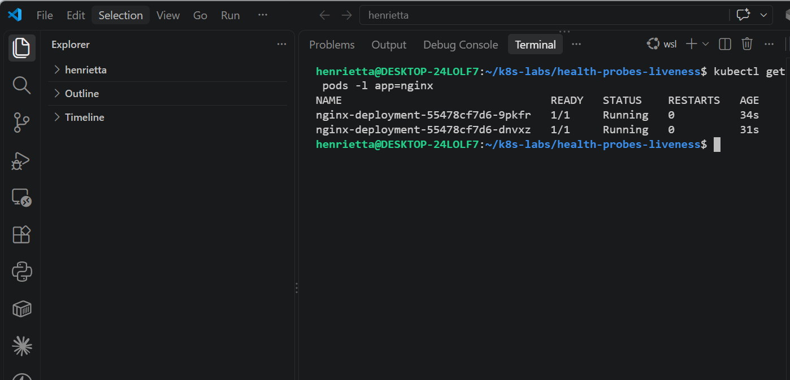

---

### Notes

**1. Why did the liveness probe fail?**

The liveness probe failed because the HTTP GET path was intentionally misconfigured to /does-not-exist, which returned a 404 Not Found error response from the NGINX web server.

**2. What happened after Kubernetes detected repeated liveness-probe failures?**

After reaching the failure threshold (3 consecutive failed checks), Kubernetes marked the container as unhealthy, automatically terminated/destroyed the container, and started a new container instance in its place.

**3. What does the RESTARTS column prove?**

The RESTARTS column incrementing proves that Kubernetes actively monitored the container's health, detected the repeated liveness probe failures, and automatically performed container restarts to recover the workload.

**4. How did you restore the Deployment to a stable state?**

The Deployment was restored by reapplying the original, correct liveness manifest (kubectl apply -f 01-nginx-deploy-liveness.yaml), which fixed the probe path back to / and stopped the restart loop

---

# Task 5 — Optional: Observe a Restart Loop

## Goal

Observe why overly aggressive or incorrectly configured liveness probes can create restart loops.

Complete this section only if you attempt Task 5. Otherwise, mark it as “Not attempted.”

**Task status:** Completed / Not attempted

### Evidence

#### Optional Screenshot — Pod output showing the RESTARTS count increasing during the restart-loop observation

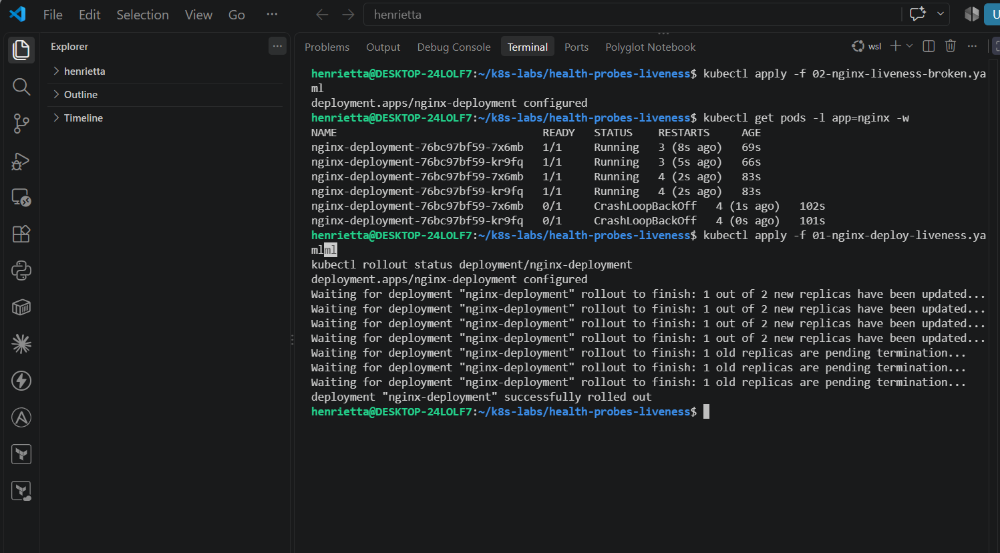

No specific restart count or CrashLoopBackOff status is required.

---

### Notes — Answer Only If Attempted

**1. What is a restart loop?**

A restart loop occurs when a container repeatedly fails its liveness probe or encounters a fatal startup error, causing Kubernetes to continuously terminate and restart it in an endless cycle (often indicated by CrashLoopBackOff status).

**2. Why can an aggressive liveness probe be harmful?**

If liveness checks are configured with excessively short periods or low thresholds (initialDelaySeconds or periodSeconds set too tight), a temporary network glitch, brief high CPU load, or slow startup can cause false positives, unnecessarily killing and restarting healthy containers.

**3. Why should liveness checks be lightweight and carefully tuned?**

They must be lightweight to avoid consuming excessive application resources or adding unnecessary overhead to the server, and carefully tuned to ensure they only trigger restarts on true deadlocks or unrecoverable application freezes.

---

# Task 6 — Share Your Liveness-Probe Learning on LinkedIn

## Goal

Mastering Kubernetes Reliability: Understanding Liveness Probes & Preventing Restart Loops

Share what you learned about Kubernetes liveness probes, container restarts, and the difference between readiness and liveness.

### Evidence

#### Screenshot 12 — Published LinkedIn post

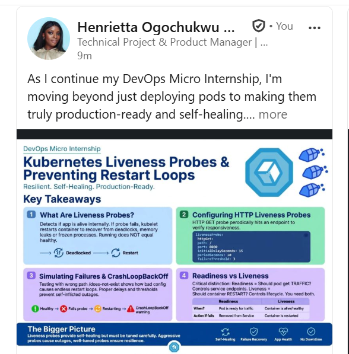

#### Linkedin post URL

https://lnkd.in/p/dWcXGsaG

---

# Submission Instructions

- Add all required screenshots numbered 1–12.
- Include the optional Task 5 screenshot only if you attempt that task.
- Ensure your full name is visible in required screenshots.
- Use clear, readable screenshots showing the relevant manifest or output.
- Include the completed baseline and liveness-probe manifests in your repository.
- Answer all Notes questions for Tasks 1–4 in your own words.
- If you attempt Task 5, complete its Notes and restore the working configuration afterward.
- Do not expose tokens, passwords, kubeconfig files, account IDs, or other sensitive information.

---

# Completion Checklist

- [ ] Learning cluster confirmed and previous assignment resources removed where applicable
- [ ] Liveness-probe lab directory created (Screenshot 1)
- [ ] Baseline Deployment manifest completed (Screenshot 2)
- [ ] Successful rollout and two baseline Pods verified (Screenshot 3)
- [ ] Baseline Deployment details reviewed (Screenshot 4)
- [ ] Liveness probe added successfully (Screenshot 5)
- [ ] Successful liveness-probe rollout verified (Screenshot 6)
- [ ] Liveness-probe details inspected (Screenshot 7)
- [ ] Broken liveness configuration created (Screenshot 8)
- [ ] Increased container restart count observed (Screenshot 9)
- [ ] Liveness-probe failure events or restart details captured (Screenshot 10)
- [ ] Working liveness configuration restored and stable Pods verified (Screenshot 11)
- [ ] Optional Task 5 evidence and Notes completed, if attempted
- [ ] Working configuration restored after Task 5, if attempted
- [ ] LinkedIn post published (Screenshot 12)
- [ ] Notes for Tasks 1–4 completed
- [ ] Required manifests included
- [ ] All required screenshots are clear and readable
- [ ] No sensitive data exposed

---

## 📌 About DMI & CloudAdvisory

DevOps Micro Internship (DMI) is a project-based DevOps program run by Pravin Mishra (The CloudAdvisory) focused on real-world execution, systems thinking, and career readiness.

It helps learners build strong DevOps foundations with hands-on experience.

---

## 📌 Resources

- 🌐 DMI Official Website: https://dmi.pravinmishra.com?utm_source=github&utm_medium=readme  
- 🎓 University: https://university.pravinmishra.com?utm_source=github&utm_medium=readme  
- 💬 Discord Community: https://discord.pravinmishra.com?utm_source=github&utm_medium=readme  
- 📝 Blog: https://dmi.pravinmishra.com/blog?utm_source=github&utm_medium=readme  
- ▶️ YouTube Playlist: https://www.youtube.com/playlist?list=PLFeSNDtI4Cho  
- 🔗 Pravin Mishra (LinkedIn): https://www.linkedin.com/in/pravin-mishra-aws-trainer/  
- 🏢 CloudAdvisory (LinkedIn): https://www.linkedin.com/company/thecloudadvisory/

---

*This submission is part of DevOps Micro Internship (DMI) — Agentic AI Track.*
