# Assignment 7 — Kubernetes Services (ClusterIP)

Part of the DevOps Micro Internship (DMI) with Agentic AI

---

## Purpose

In this assignment, you will create and test a Kubernetes ClusterIP Service. You will connect it to a healthy NGINX Deployment, access it using DNS and its ClusterIP, break and restore its selector, and observe how readiness affects Service routing.

---

# Task 0 — Prepare the Lab Environment

## Goal

Confirm your learning-cluster context and remove previous lab resources where applicable before starting this assignment.

No screenshot or written notes are required for this pre-check.

---

# Task 1 — Set Up Your Lab Directory

## Goal

Create and enter a dedicated directory for the ClusterIP Service lab.

### Evidence

#### Screenshot 1 — Terminal showing that you are working inside `~/k8s-labs/services/clusterip`

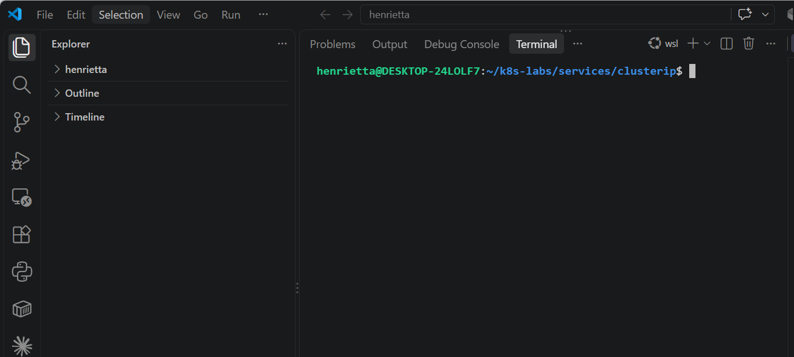

---

### Notes

**1. Why is it not reliable to communicate with an application using a Pod IP address?**

Pod IP addresses are ephemeral and dynamic. Whenever a Pod crashes, gets rescheduled, or undergoes a rolling update/scaling operation, it gets assigned a completely new IP address. Relying directly on Pod IPs would break application connectivity constantly.

**2. What Kubernetes resource provides a stable internal address for a group of Pods?**

A Service (specifically a ClusterIP Service) provides a single, stable virtual IP address and DNS name that reliably routes traffic to a changing set of backend Pods

---

# Task 2 — Create a Healthy NGINX Deployment

## Goal

Create an NGINX Deployment with labels, readiness probes, and liveness probes that can act as the backend for a Service.

### Evidence

#### Screenshot 2 — Completed `00-nginx-deploy.yaml` manifest

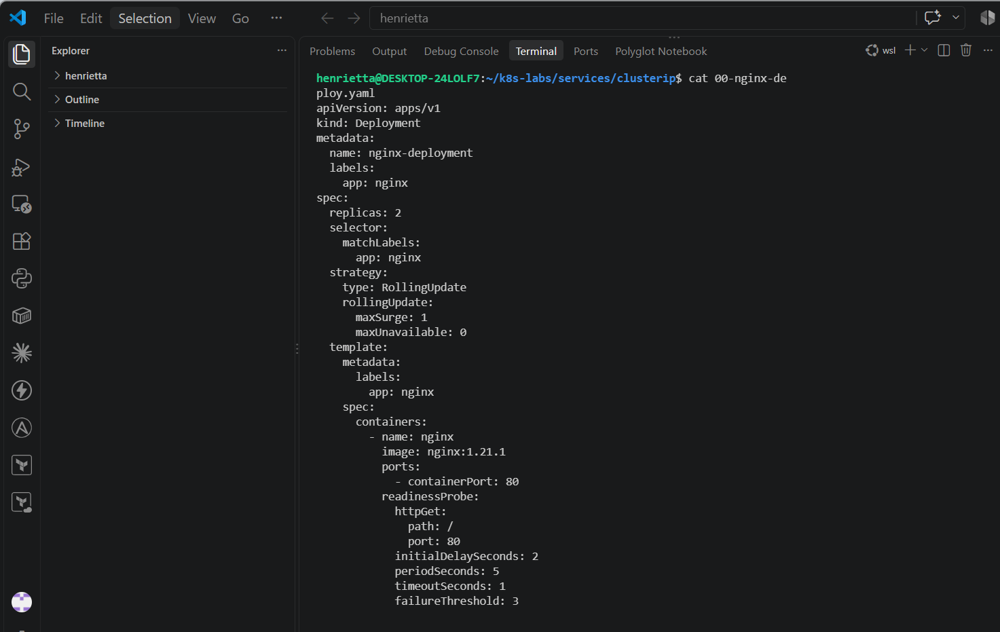

---

#### Screenshot 3 — Output showing successful rollout and two ready NGINX Pods

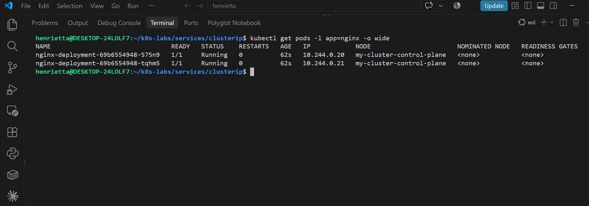

---

### Notes

**1. Which label will the Service use to find these Pods?**

The Service will use the label selector app: nginx, which matches the labels defined on both the Deployment template and the created Pods.

**2. Why is readiness important before connecting Pods to a Service?**

A readiness probe ensures that a container has finished initializing and is fully prepared to handle live client traffic before the Service routes requests to it, preventing users from hitting half-started or unready instances

**3. What port does the NGINX container listen on?**

The NGINX container listens on container port 80

---

# Task 3 — Create a ClusterIP Service

## Goal

Create a stable internal Service that routes traffic to the NGINX Pods.

### Evidence

#### Screenshot 4 — Completed `01-nginx-svc-clusterip.yaml` manifest

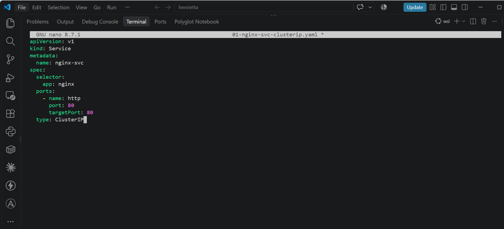

---

#### Screenshot 5 — Output showing the ClusterIP Service, endpoints, or EndpointSlices

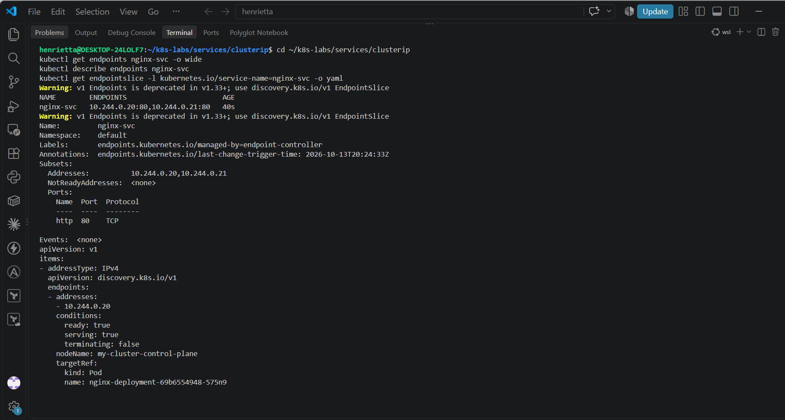
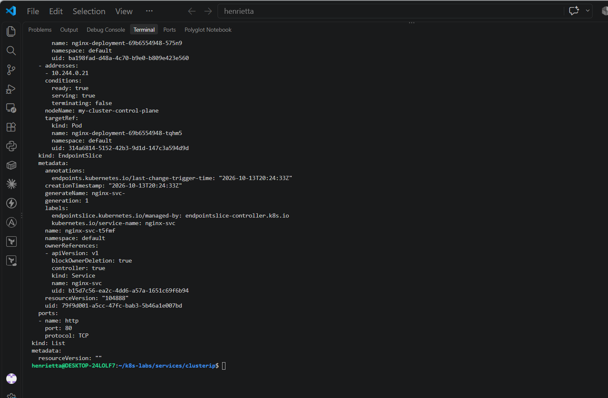

---

### Notes

**1. What is the purpose of a ClusterIP Service?**

A ClusterIP Service provides a stable, single internal IP address and DNS name for a set of Pods, enabling reliable load-balanced communication inside the cluster without exposing the application externally.

**2. What is the difference between `port` and `targetPort`?**

port is the port exposed by the Service itself (where other pods send requests), whereas targetPort is the port on the backend Pod containers (port 80 for NGINX) where traffic is forwarded.

**3. Why must the Service selector match the Pod labels?**

The Service uses the selector as a query filter to dynamically discover which Pods belong to its backend pool. If the selector doesn't match the Pod labels, the Service will find zero backends and won't be able to route traffic

**4. What information do EndpointSlices contain?**

EndpointSlices contain detailed network information about the backend endpoints backing a Service, including the specific Pod IP addresses, ports, and readiness status (ready: true/false).

---

# Task 4 — Access the Service from Inside the Cluster

## Goal

Create a client Pod and access the NGINX Service using DNS and its ClusterIP.

### Evidence

#### Screenshot 6 — Output showing the `tester` Pod running

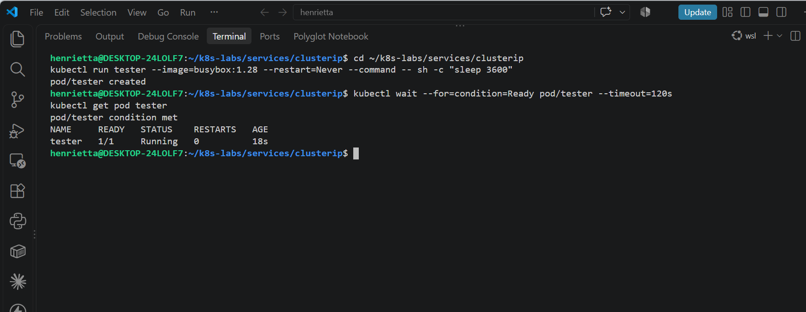

---

#### Screenshot 7 — Successful Service request using DNS name and ClusterIP

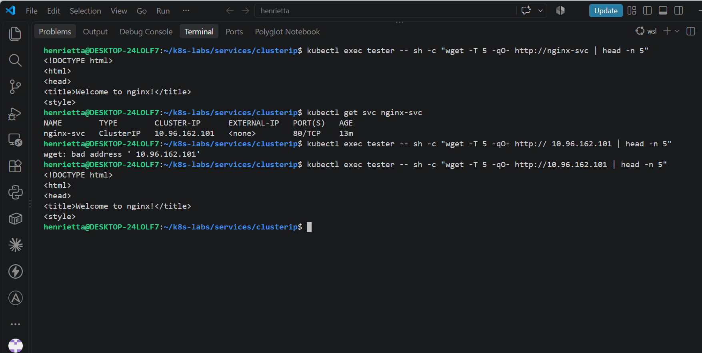

---

#### Screenshot 8 — Successful DNS lookup for the Service

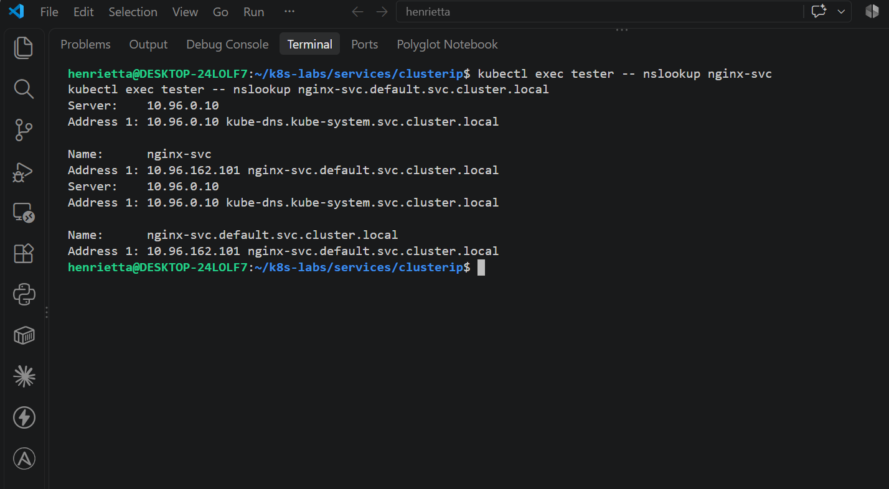

---

### Notes

**1. Why should an application use `nginx-svc` instead of a Pod IP address?**

An application should use nginx-svc because Pod IPs change dynamically whenever pods are recreated or scaled, whereas the Service name (nginx-svc) provides a stable, persistent address that automatically routes traffic to the correct active backends.

**2. What does the DNS name `nginx-svc.default.svc.cluster.local` represent?**

It represents the fully qualified domain name (FQDN) of the Service within the cluster, consisting of the service name (nginx-svc), namespace (default), service domain (svc), and cluster root domain (cluster.local).

**3. Why can the client access the Service even if the backend Pod IPs change?**

The client communicates with the stable ClusterIP or DNS name of the Service. Kubernetes automatically updates the backend EndpointSlices behind the scenes whenever Pod IPs change, so client requests are transparently redirected to the new healthy Pod IPs without needing client configuration updates.

---

# Task 5 — Break and Restore the Label-Selector Contract

## Goal

Break the Service selector, observe that usable endpoints disappear, and then restore the correct selector.

### Evidence

#### Screenshot 9 — `02-nginx-svc-selector-broken.yaml` showing the incorrect selector

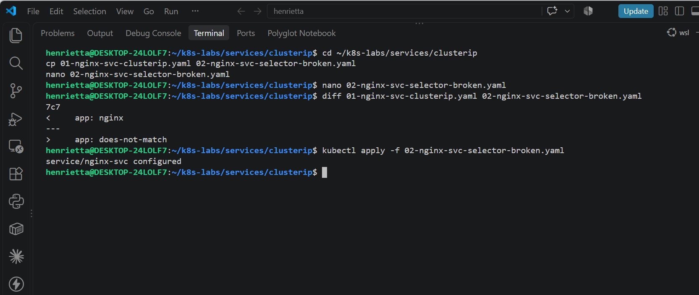

---

#### Screenshot 10 — Empty endpoints or EndpointSlice output after applying the broken selector

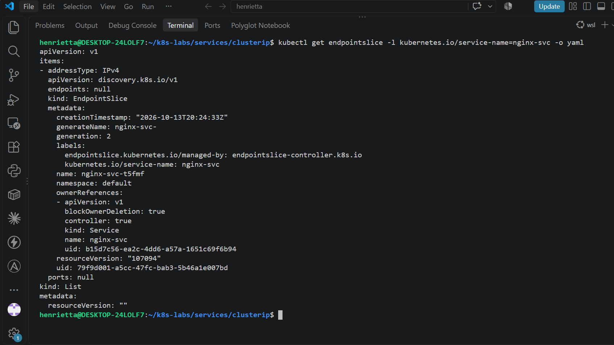

---

#### Screenshot 11 — Failed request output from the `tester` Pod

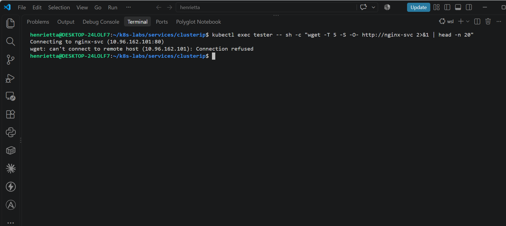

---

#### Screenshot 12 — Restored endpoints and successful Service request

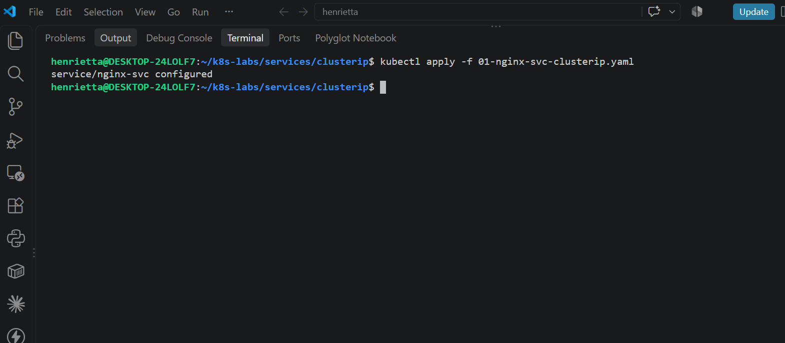

---

### Notes

**1. Why did the Service endpoints become empty?**

The Service relies strictly on its label selector (app: does-not-match) to dynamically locate backend pods. Because no pods matched this new label, Kubernetes cleared all endpoints from the EndpointSlice.

**2. What caused the request from the client Pod to fail?**

While the Service virtual IP and DNS name still existed, there were zero active backend endpoints available behind it to handle traffic, resulting in a connection refusal or timeout.

**3. How did you restore connectivity to the NGINX Pods?**

Connectivity was restored by reapplying the original working Service manifest (01-nginx-svc-clusterip.yaml) with the correct selector (app: nginx), which immediately repopulated the endpoints.

---

# Task 6 — Observe How Readiness Affects Service Routing

## Goal

Observe how a new Pod that fails readiness is excluded from ready Service backends while the existing healthy Pod continues serving traffic.

### Evidence

#### Screenshot 13 — Output showing the Deployment scaled to one ready Pod

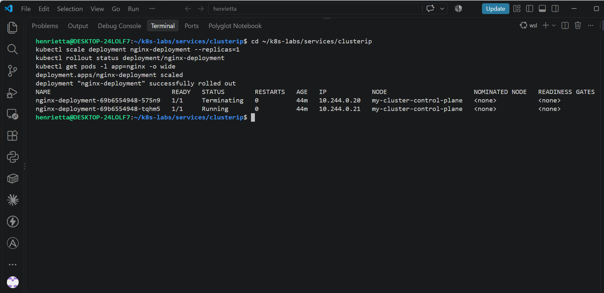

---

#### Screenshot 14 — Completed `03-readiness-broken.yaml` patch file

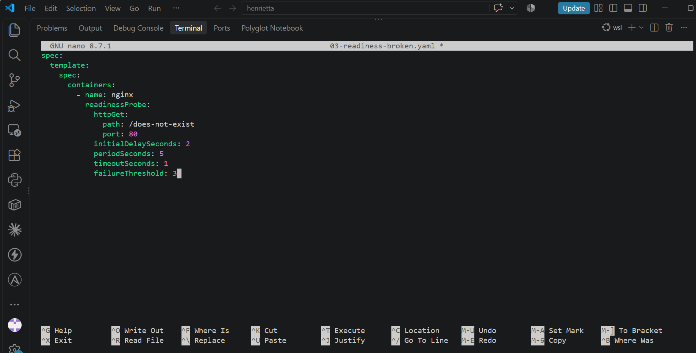

---

#### Screenshot 15 — Output showing the expected incomplete rollout or NotReady Pod

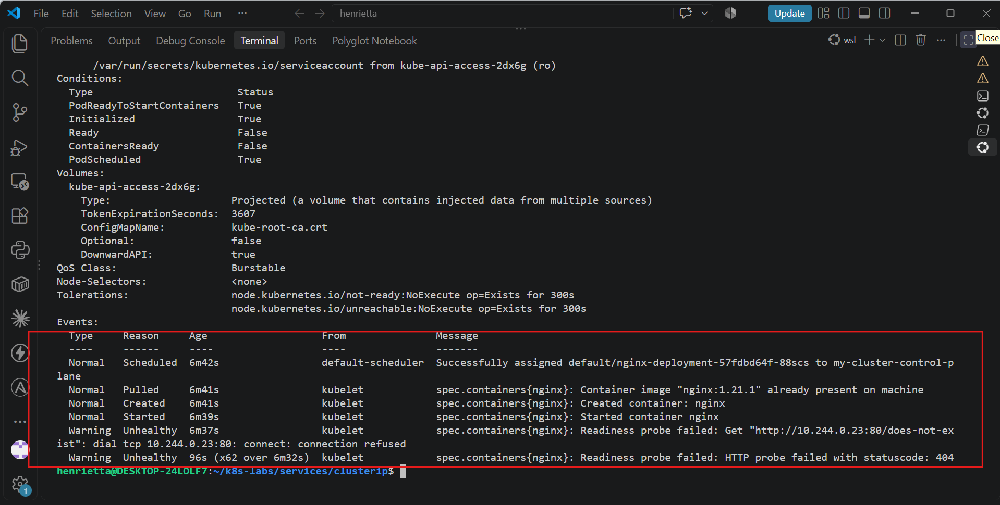

---

#### Screenshot 16 — EndpointSlice output showing the healthy Pod with `ready: true` and the new NotReady Pod with `ready: false`

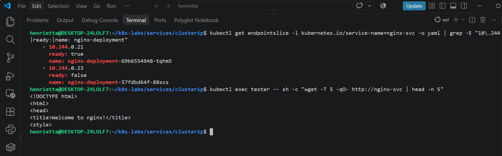

---

#### Screenshot 17 — Service EndpointSlice output showing ready backends after restoring the Deployment

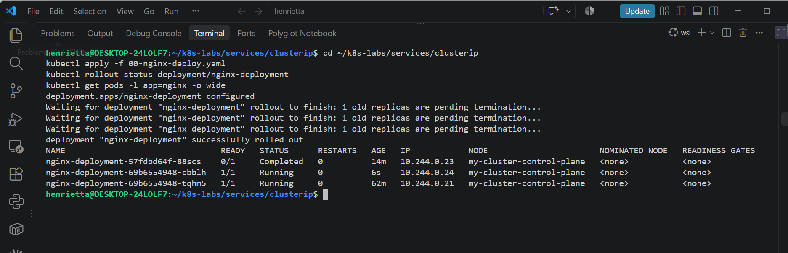

---

### Notes

**1. Why was the new NotReady Pod excluded from ready Service backends?**

Because its readiness probe failed (returning a 404 status code on /does-not-exist), Kubernetes marked the Pod as unready (ready: false) in the EndpointSlice, automatically removing it from the Service's active routing pool.

**2. What is the relationship between readiness probes and Service routing?**

Readiness probes act as a traffic gatekeeper for Services. A Service only routes traffic to backend endpoints that have ready: true status in their EndpointSlice.

**3. Why does this behavior protect users from unhealthy application instances?**

It ensures that client traffic is never directed to half-initialized, failing, or newly deployed pods until they have passed their health checks and proven they can successfully serve requests.

---

# Task 7 — Share Your ClusterIP Service Learning on LinkedIn

## Goal

Share what you learned about ClusterIP Services, Kubernetes DNS, selectors, and readiness-aware Service routing.

### Evidence

#### Screenshot 18 — Published LinkedIn post

Add your screenshot here.

#### Linkedin post link

Paste your link here

---

# Submission Instructions

- Add all required screenshots numbered 1–18.
- Ensure your full name is visible in required screenshots.
- Use clear, readable screenshots showing the relevant manifest or output.
- Include the completed NGINX Deployment and ClusterIP Service manifests in your repository.
- Answer all Notes questions for Tasks 1–6 in your own words.
- Include evidence of the intentional failures and successful recovery.
- Do not expose tokens, passwords, kubeconfig files, account IDs, or other sensitive information.

---

# Completion Checklist

- [ ] Learning-cluster context confirmed and previous lab resources removed where applicable
- [ ] ClusterIP lab directory created (Screenshot 1)
- [ ] Healthy NGINX Deployment manifest completed (Screenshot 2)
- [ ] Successful rollout and two ready NGINX Pods verified (Screenshot 3)
- [ ] ClusterIP Service manifest completed (Screenshot 4)
- [ ] Service and backend endpoints or EndpointSlices verified (Screenshot 5)
- [ ] Client Pod created and running (Screenshot 6)
- [ ] Service accessed using DNS name and ClusterIP (Screenshot 7)
- [ ] Service DNS resolution verified (Screenshot 8)
- [ ] Broken selector manifest created (Screenshot 9)
- [ ] Empty endpoints observed (Screenshot 10)
- [ ] Failed Service request captured (Screenshot 11)
- [ ] Original selector restored and connectivity verified (Screenshot 12)
- [ ] Deployment scaled to one ready Pod (Screenshot 13)
- [ ] Broken readiness patch created (Screenshot 14)
- [ ] Incomplete rollout or NotReady Pod observed (Screenshot 15)
- [ ] Readiness effect on Service backends verified (Screenshot 16)
- [ ] Deployment restored and ready Service backends verified (Screenshot 17)
- [ ] LinkedIn post published (Screenshot 18)
- [ ] Notes for Tasks 1–6 completed
- [ ] Required manifests included
- [ ] All required screenshots are clear and readable
- [ ] No sensitive data exposed

---

## 📌 About DMI & CloudAdvisory

DevOps Micro Internship (DMI) is a project-based DevOps program run by Pravin Mishra (The CloudAdvisory) focused on real-world execution, systems thinking, and career readiness.

It helps learners build strong DevOps foundations with hands-on experience.

---

## 📌 Resources

- 🌐 DMI Official Website: https://dmi.pravinmishra.com?utm_source=github&utm_medium=readme  
- 🎓 University: https://university.pravinmishra.com?utm_source=github&utm_medium=readme  
- 💬 Discord Community: https://discord.pravinmishra.com?utm_source=github&utm_medium=readme  
- 📝 Blog: https://dmi.pravinmishra.com/blog?utm_source=github&utm_medium=readme  
- ▶️ YouTube Playlist: https://www.youtube.com/playlist?list=PLFeSNDtI4Cho  
- 🔗 Pravin Mishra (LinkedIn): https://www.linkedin.com/in/pravin-mishra-aws-trainer/  
- 🏢 CloudAdvisory (LinkedIn): https://www.linkedin.com/company/thecloudadvisory/

---

*This submission is part of DevOps Micro Internship (DMI) — Agentic AI Track.*
