# Assignment 8 — Kubernetes Services (NodePort)

Part of the DevOps Micro Internship (DMI) with Agentic AI

---

## Purpose

Create a healthy NGINX Deployment, expose it through a NodePort Service, test access using a node IP and NodePort, and observe how the Service behaves when a backend Pod is replaced.

---

# Task 1 — Set Up Your Lab Directory

## Goal

Create and enter a dedicated directory for the NodePort Service lab.

### Evidence

#### Screenshot 1 — Terminal showing that you are working inside `~/k8s-labs/services/nodeport`

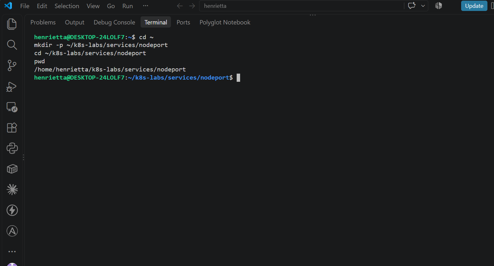

### Notes

**1. What is the difference between ClusterIP and NodePort?**

A ClusterIP Service is only accessible internally within the cluster using a virtual IP. A NodePort Service extends ClusterIP by also allocating a specific static port across every node's IP address, allowing external traffic from outside the cluster to reach the service.

**2. What does a NodePort Service allow users to do?**

It allows external clients or networks outside the Kubernetes cluster to access applications running inside pods by connecting directly to any node's IP address on the designated port (typically in the 30000-32767 range).

---

# Task 2 — Create a Healthy NGINX Deployment

## Goal

Create a healthy NGINX Deployment that can act as the backend for the NodePort Service.

### Evidence

#### Screenshot 2 — Completed `00-nginx-deploy.yaml` manifest

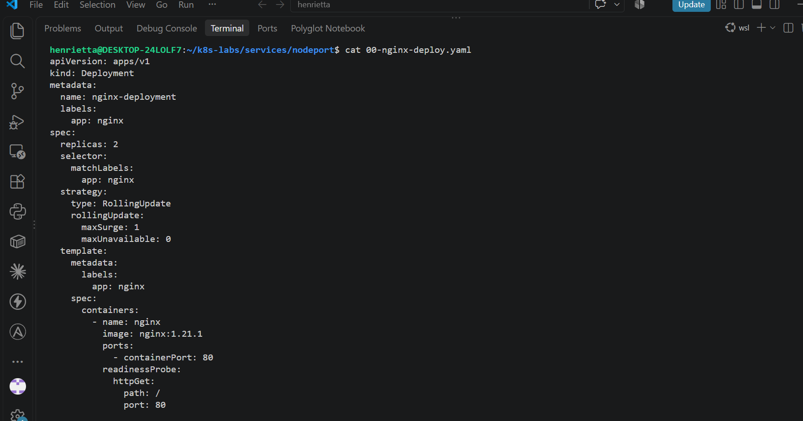

---

#### Screenshot 3 — Output showing successful rollout and two ready NGINX Pods

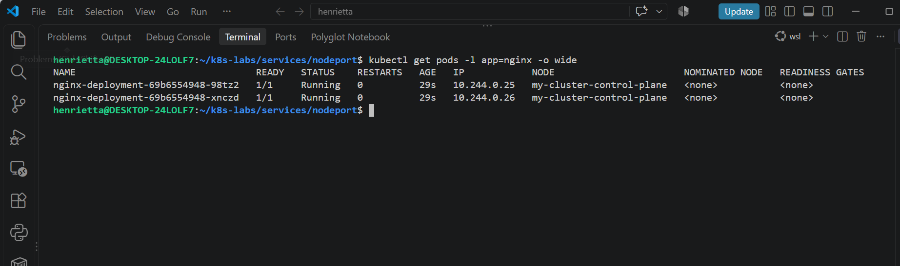

### Notes

**1. Which label will the NodePort Service use to find the NGINX Pods?**

The NodePort Service will use the label selector app: nginx, which matches the labels defined on both the Deployment template and the created Pods.

**2. Why must the Pods be ready before they can receive Service traffic?**

Pods must be ready to ensure their containers have finished initializing and are fully capable of serving HTTP traffic, protecting clients from being routed to unready instances

**3. What port does the NGINX container listen on?**

The NGINX container listens on container port 80.

---

# Task 3 — Create the NodePort Service

## Goal

Create a NodePort Service that exposes the NGINX application through a port on every cluster node.

### Evidence

#### Screenshot 4 — Completed `01-nginx-svc-nodeport.yaml` manifest

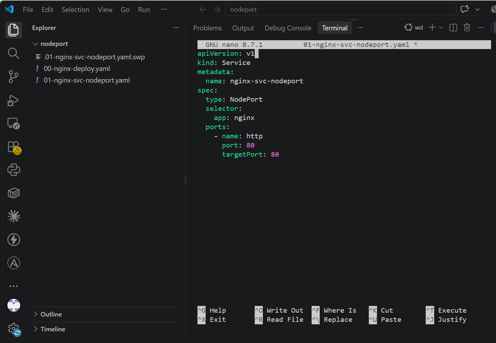

---

#### Screenshot 5 — Output showing the NodePort Service and its endpoints or EndpointSlices

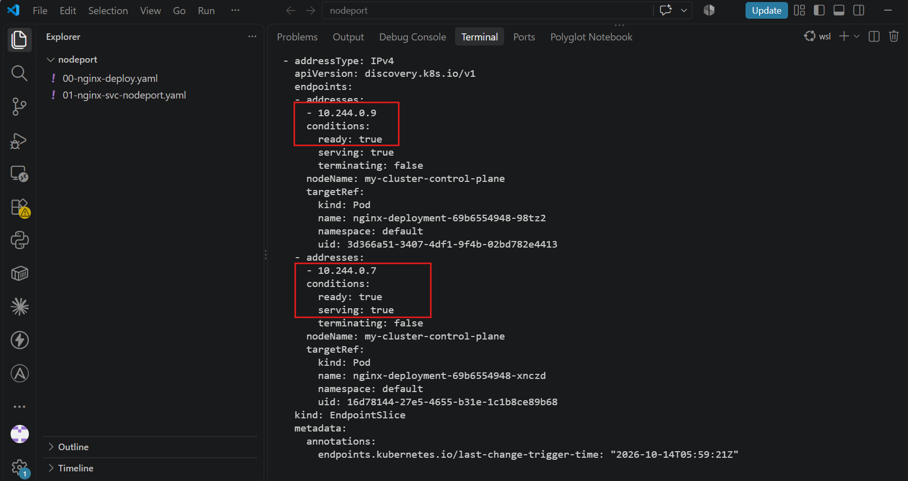

### Notes

**1. What is the purpose of `type: NodePort`?**

It exposes the Service externally on a static port across all cluster node IP addresses, enabling traffic originating from outside the cluster to reach the internal pods.

**2. What is the difference between `port`, `targetPort`, and `nodePort`?**

port: The virtual port exposed by the Service internally within the cluster.

targetPort: The port on the container inside the pod where traffic is forwarded (port 80 for NGINX).

nodePort: The external static port opened on every cluster node (typically in the 30000-32767 range) to accept external requests.

**3. What NodePort was assigned or selected in your environment?**

(Check your kubectl get svc output from Step 3—for example, 30124).

**4. Why do Service endpoints need ready Pods?**

Services only route traffic to endpoints marked as ready in their EndpointSlices to ensure clients are never sent to uninitialized, crashing, or failing containers.

---

# Task 4 — Find a Node IP and Test the NodePort

## Goal

Find a reachable node IP and access the NodePort Service.

### Evidence

#### Screenshot 6 — Output of `kubectl get nodes -o wide`

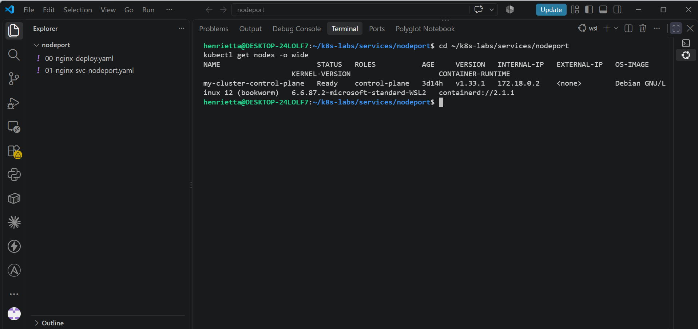

---

#### Screenshot 7 — Output showing the `tester` Pod running

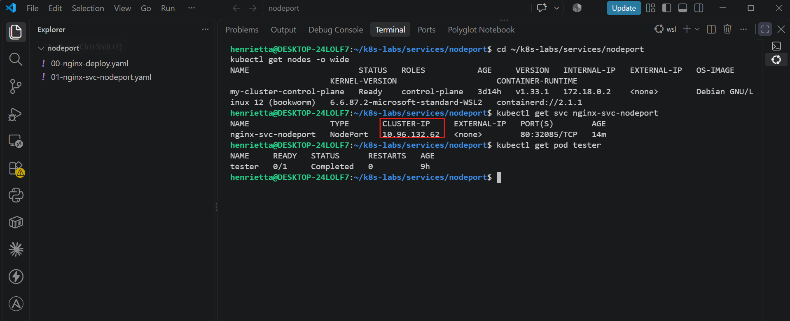

---

#### Screenshot 8 — Successful NodePort response from the laptop or the `tester` Pod

If neither route is supported by your environment, include the failed request output and ready endpoint evidence, and explain the limitation in your Notes.

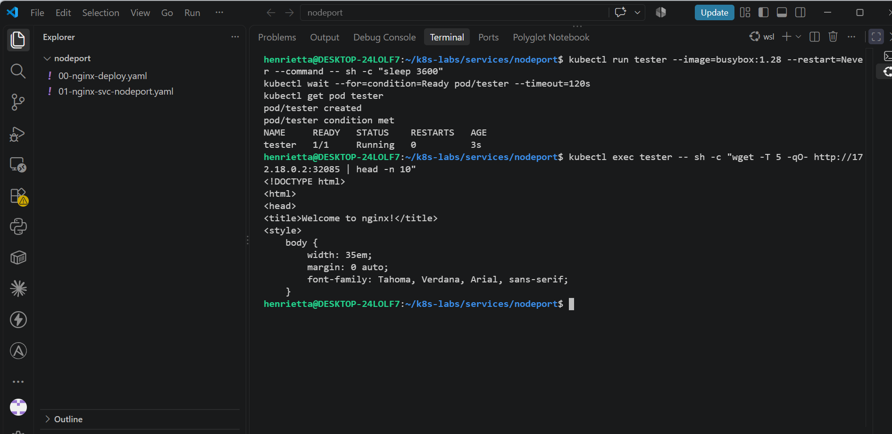

### Notes

**1. Which node IP and NodePort did you test?**

Node IP: 172.18.0.2, NodePort: 32085

**2. Was your laptop able to reach the NodePort directly? Explain your result.**

No, direct requests from the host/WSL terminal fail or time out because Kind runs cluster nodes as isolated Docker containers on a private internal bridge network (172.18.0.2), making the node IP unreachable directly from the host machine without explicit port mappings or ingress. Testing must be performed from inside the cluster using a client pod.

**3. Why can external NodePort access behave differently in Minikube, kind, Docker Desktop, and cloud clusters?**

Each environment handles local virtualization and networking differently. For instance, Minikube uses VMs or driver bridges, Kind runs nodes as Docker containers on a private bridge network, Docker Desktop exposes ports via internal routing proxies, and cloud providers integrate NodePorts directly with cloud load balancers or VPC routing tables.

---

# Task 5 — Optional: Test the Label-Selector Contract

## Goal

Break the Service selector, observe that usable endpoints disappear, and restore the correct selector.

Complete the Evidence and Notes below only if you attempted this optional task.

### Evidence

#### Screenshot 9 — `02-nginx-svc-selector-broken.yaml` showing the incorrect selector

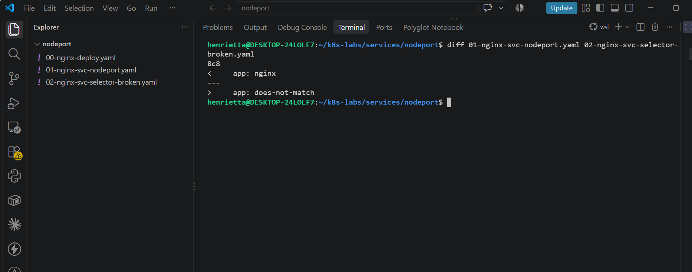

---

#### Screenshot 10 — Empty endpoints or EndpointSlice output after applying the broken selector

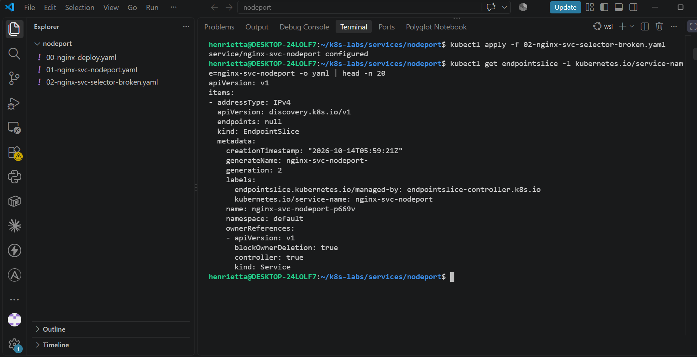

---

#### Screenshot 11 — Restored endpoints or EndpointSlices after applying the original Service manifest

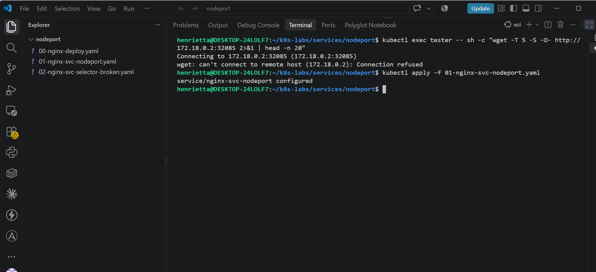

### Notes

**1. Why did the Service endpoints become empty?**

Because the Service's label selector was changed to app: does-not-match, it no longer matched the labels on any running NGINX pods, causing Kubernetes to remove all backend addresses from the EndpointSlice.

**2. Why is NodePort only useful when matching ready Pods exist?**

A NodePort Service is merely a routing entry point across node interfaces; if there are no matching healthy pods behind it, external requests have no destination container to forward traffic to, resulting in connection timeouts or refusals.

**3. How did you restore the backend connectivity?**

By reapplying the original working NodePort manifest (01-nginx-svc-nodeport.yaml) with the correct selector (app: nginx), which immediately re-established the endpoints.

---

# Task 6 — Observe Resilience During Pod Churn

## Goal

Delete one NGINX Pod and observe its replacement while the Service continues routing traffic to available Pods.

### Evidence

#### Screenshot 12 — Output of the Pod deletion command

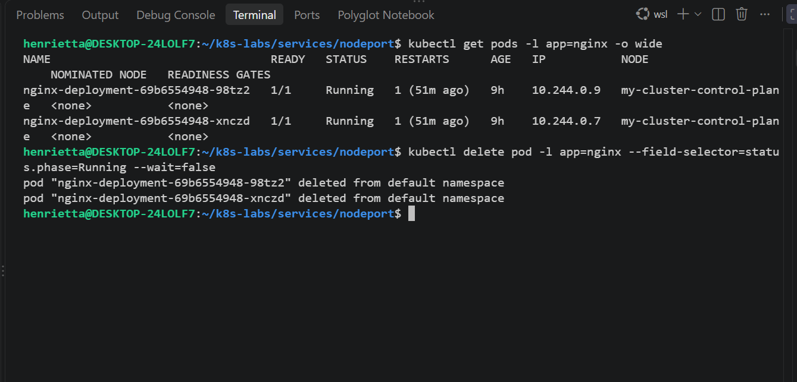

---

#### Screenshot 13 — Output showing the replacement Pod and two running, ready Pods

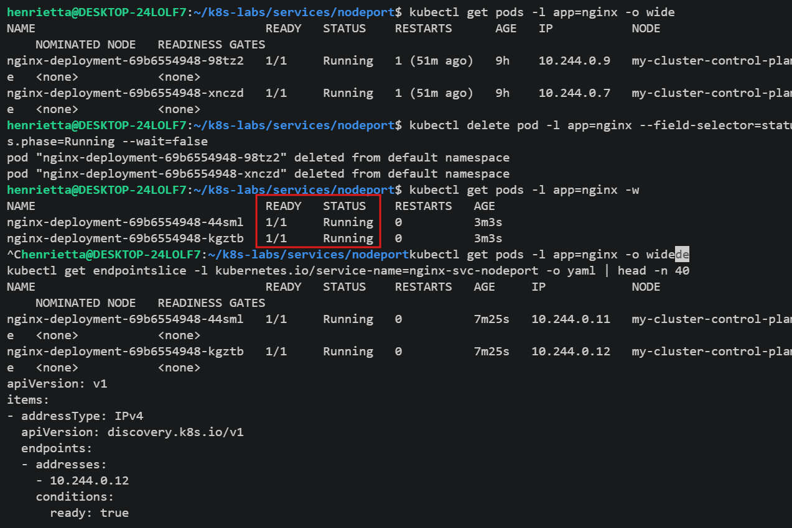

### Notes

**1. What happened after you deleted one Pod?**

Kubernetes immediately initiated termination of the deleted pod while the surviving pod continued handling requests. Simultaneously, the ReplicaSet detected that the pod count dropped below the desired replica count (2) and automatically provisioned a brand new replacement pod.

**2. Which Kubernetes resource created the replacement Pod?**

The ReplicaSet (managed by the Deployment) created the replacement pod to maintain the desired state of two replicas.

**3. Why can the NodePort Service continue working during Pod churn?**

Because the NodePort Service routes traffic to endpoints based on pod readiness. As long as at least one healthy backend pod remains running and ready, client requests continue to be served successfully while rolling replacements occur behind the scenes.

---

# Task 7 — Share Your NodePort Learning on LinkedIn

## Goal

Share what you learned about NodePort Services, backend Pods, and network access in your Kubernetes environment.

Share Your NodePort Service Learning on LinkedIn

### Evidence

#### Screenshot 14 — Published LinkedIn post about your NodePort Service lab

Add your screenshot here.

#### Linkedin post link

Add your Linkdin post link.

---

# Submission Instructions

- Include the completed YAML manifests created during the lab.
- Add all required screenshots: Screenshots 1–8 and 12–14.
- Include Screenshots 9–11 only if you attempted optional Task 5.
- Complete the Notes for Tasks 1–4 and Task 6.
- Complete Task 5 Notes only if you attempted that task.
- Use clear, readable screenshots showing the relevant commands and outputs.
- Ensure your full name is visible in the required screenshots.
- If NodePort access is restricted by your environment, include the failed request output, ready endpoint evidence, and an explanation.
- Do not expose passwords, access tokens, private keys, kubeconfig contents, or account IDs.

---

# Completion Checklist

- [ ] Created and entered `~/k8s-labs/services/nodeport` (Screenshot 1)
- [ ] Created and applied the NGINX Deployment manifest (Screenshot 2)
- [ ] Confirmed successful rollout and two ready NGINX Pods (Screenshot 3)
- [ ] Created the NodePort Service manifest (Screenshot 4)
- [ ] Verified the Service and its endpoints or EndpointSlices (Screenshot 5)
- [ ] Recorded the assigned or selected NodePort
- [ ] Identified a node IP (Screenshot 6)
- [ ] Confirmed that the `tester` Pod is running (Screenshot 7)
- [ ] Tested NodePort access, or documented the environment limitation with evidence (Screenshot 8)
- [ ] Optional: Tested and restored the Service selector (Screenshots 9–11)
- [ ] Deleted one NGINX Pod (Screenshot 12)
- [ ] Confirmed the replacement Pod and two running, ready Pods (Screenshot 13)
- [ ] Completed all required Notes
- [ ] Published the LinkedIn post (Screenshot 14)
- [ ] No sensitive data exposed

---

## 📌 About DMI & CloudAdvisory

DevOps Micro Internship (DMI) is a project-based DevOps program run by Pravin Mishra (The CloudAdvisory) focused on real-world execution, systems thinking, and career readiness.

It helps learners build strong DevOps foundations with hands-on experience.

---

## 📌 Resources

- 🌐 DMI Official Website: https://dmi.pravinmishra.com?utm_source=github&utm_medium=readme  
- 🎓 University: https://university.pravinmishra.com?utm_source=github&utm_medium=readme  
- 💬 Discord Community: https://discord.pravinmishra.com?utm_source=github&utm_medium=readme  
- 📝 Blog: https://dmi.pravinmishra.com/blog?utm_source=github&utm_medium=readme  
- ▶️ YouTube Playlist: https://www.youtube.com/playlist?list=PLFeSNDtI4Cho  
- 🔗 Pravin Mishra (LinkedIn): https://www.linkedin.com/in/pravin-mishra-aws-trainer/  
- 🏢 CloudAdvisory (LinkedIn): https://www.linkedin.com/company/thecloudadvisory/

---

*This submission is part of DevOps Micro Internship (DMI) — Agentic AI Track.*
