# Assignment 09 — Kubernetes Services: LoadBalancer on AKS

Part of the DevOps Micro Internship (DMI) with Agentic AI

---

## Purpose

Deploy a healthy NGINX application to Azure Kubernetes Service (AKS), expose it publicly using a LoadBalancer Service, observe readiness behavior, and scale the application behind the same public endpoint.

---

# Task 1 — Create or Connect to an AKS Cluster

## Goal

Create a small AKS cluster for this lab, or connect to an existing approved AKS lab cluster.

### Evidence

#### Screenshot 1 — Output of `kubectl get nodes` showing ready AKS node(s)

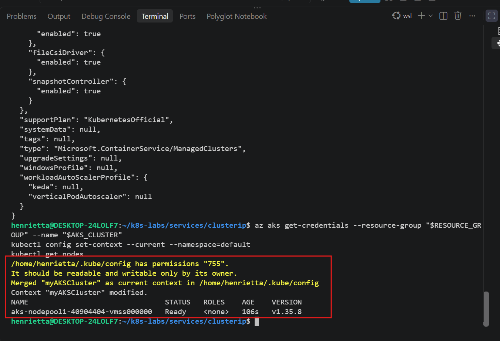

### Notes

**1. Why does this lab use a cloud-capable Kubernetes environment such as AKS for the LoadBalancer Service?**

A LoadBalancer Service relies on integration with a cloud provider's infrastructure (like Azure Load Balancers and public IP allocation APIs). Local test environments like Kind or Minikube cannot provision real external cloud load balancers without additional plugins, whereas AKS natively integrates with Azure cloud networking.

**2. What Azure resources can Kubernetes provision when a LoadBalancer Service is created?**

When a LoadBalancer Service is created in AKS, Azure provisions an external Azure Load Balancer, a public IP address, backend pool associations, and associated inbound routing rules to forward internet traffic into the cluster.

**3. Why is it important to delete unused AKS resources after the lab?**

Cloud resources like running AKS control planes, worker nodes, and active public IP addresses incur continuous financial costs on Azure subscriptions. Deleting them prevents unexpected or unnecessary billing.

---

# Task 2 — Set Up Your Lab Directory

## Goal

Create and enter a dedicated directory for the LoadBalancer Service manifests.

### Evidence

#### Screenshot 2 — Terminal showing the output of `pwd` confirming that you are working inside `~/k8s-labs/services/loadbalancer`

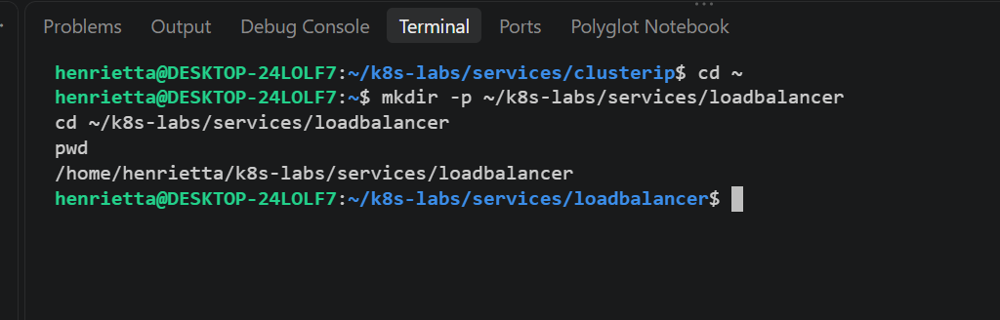

### Notes

**1. Why is it useful to keep Kubernetes manifests organized in dedicated directories?**

Dedicated directories prevent configuration file clutter, make it easier to manage resource versions per lab or application, and ensure clean execution of kubectl apply -f . or specific manifest paths without accidental overlap.

**2. What are the names of the main Deployment and LoadBalancer Service YAML files you will create in this assignment?**

00-nginx-deploy.yaml for the NGINX Deployment and 01-nginx-svc-loadbalancer.yaml for the public LoadBalancer Service (along with the readiness patch file 02-readiness-broken.yaml).

---

# Task 3 — Deploy a Healthy NGINX Application

## Goal

Create a healthy NGINX Deployment with readiness and liveness probes.

### Evidence

#### Screenshot 3 — Completed `00-nginx-deploy.yaml` manifest

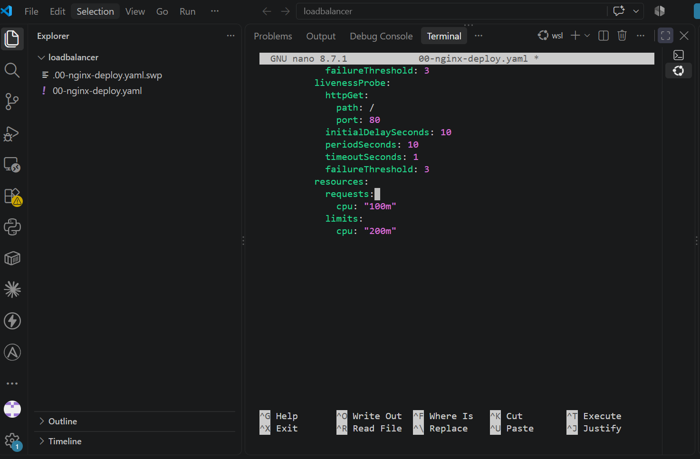

---

#### Screenshot 4 — Output showing successful rollout and two ready NGINX Pods

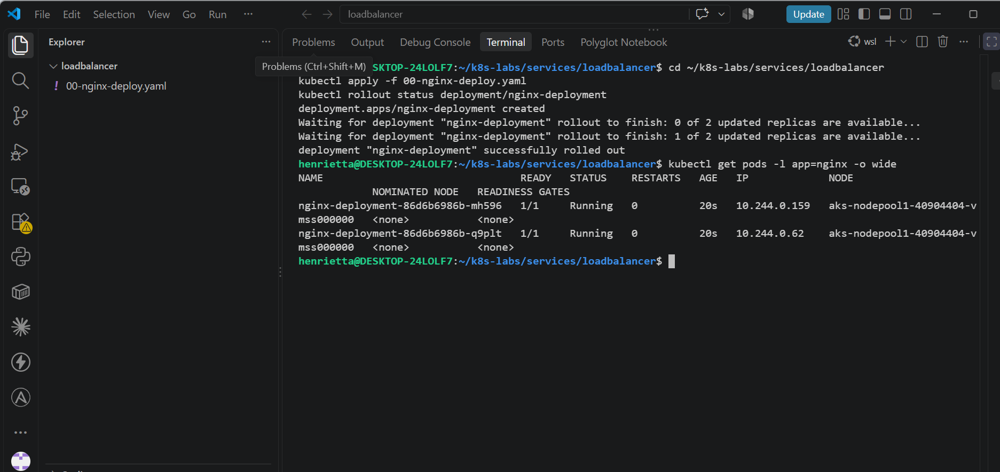

### Notes

**1. Why must Pods be ready before they should receive public traffic?**

Pods must be ready to ensure their containers have finished initializing, can successfully serve web requests, and won't drop user traffic or return errors to public clients.

**2. What is the role of the readiness probe in this Deployment?**

The readiness probe continuously checks container health (via HTTP GET on port 80); if a probe fails, Kubernetes temporarily removes that pod from the service's routing endpoints so traffic is never sent to a failing or overloaded instance.

**3. What is the role of the liveness probe in this Deployment?**

The liveness probe detects if an application container has entered a broken or deadlocked state; if it fails repeatedly, Kubernetes automatically restarts the container to restore healthy operation.

---

# Task 4 — Create and Test the LoadBalancer Service

## Goal

Create a public LoadBalancer Service and verify that the NGINX application is reachable from the internet.

### Evidence

#### Screenshot 5 — Completed `01-nginx-svc-loadbalancer.yaml` manifest

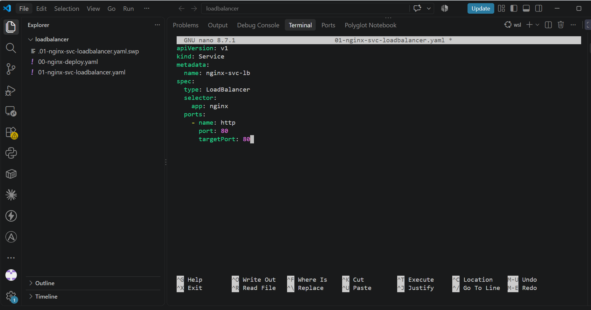

---

#### Screenshot 6 — Output showing the Service with an assigned EXTERNAL-IP

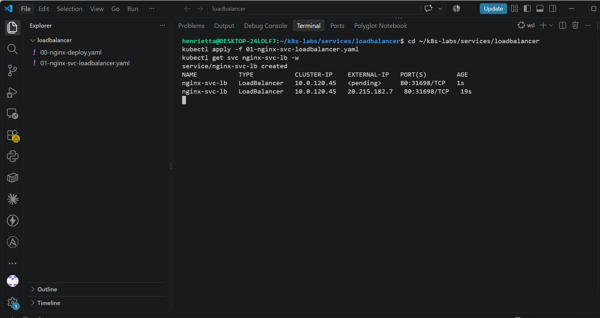

---

#### Screenshot 7 — Successful curl output from the public IP

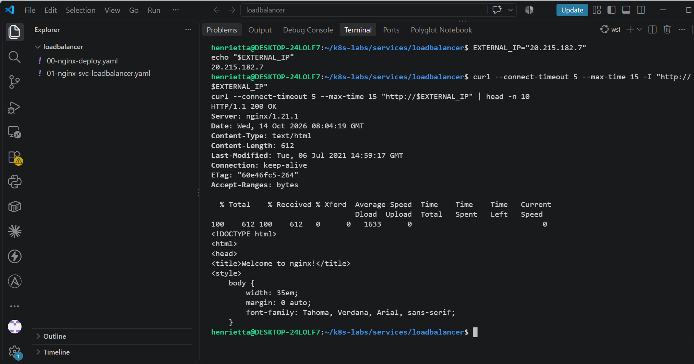

### Notes

**1. What does `type: LoadBalancer` instruct AKS to do?**

It instructs AKS to communicate with the Azure cloud provider API to automatically provision an external Azure Load Balancer, a public IP address, and associated backend pool routing rules.

**2. What public IP was assigned to your Service?**

20.215.182.7

**3. How does the public request eventually reach the NGINX Pods?**

A user's request hits the Azure public IP, gets routed through the external Azure Load Balancer into the AKS cluster nodes via NodePorts, flows through the Kubernetes LoadBalancer Service, and is directed by EndpointSlices to a ready NGINX pod.

**4. Why should you wait for EXTERNAL-IP before testing the Service?**

Until Azure finishes provisioning the cloud load balancer infrastructure and allocates the public IP address, requests have no valid network destination and will time out or fail.

---

# Task 5 — Observe How Readiness Protects Public Traffic

## Goal

Intentionally break readiness and observe how Kubernetes excludes unready Pods from ready Service backends while existing healthy Pods continue serving public traffic.

### Evidence

#### Screenshot 8 — Completed `02-readiness-broken.yaml` patch file

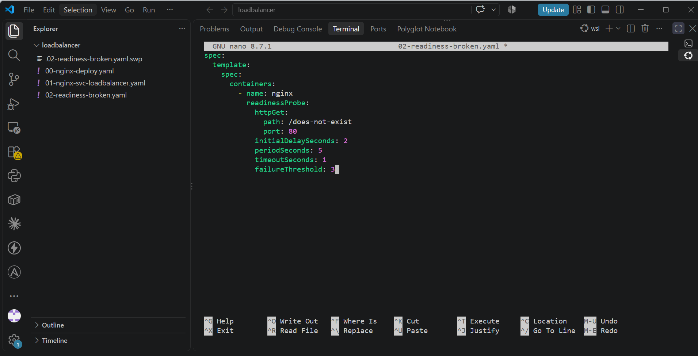

---

#### Screenshot 9 — Output showing the expected incomplete rollout or readiness failure

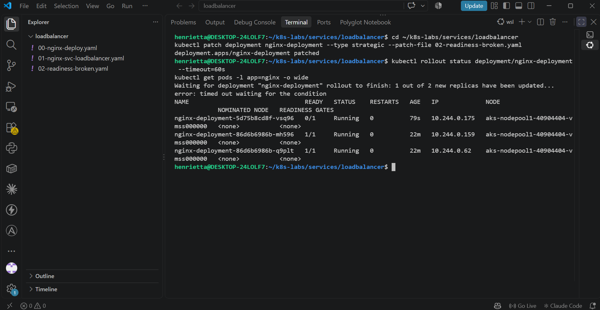

---

#### Screenshot 10 — EndpointSlice output showing ready healthy backends and the effect of the readiness failure

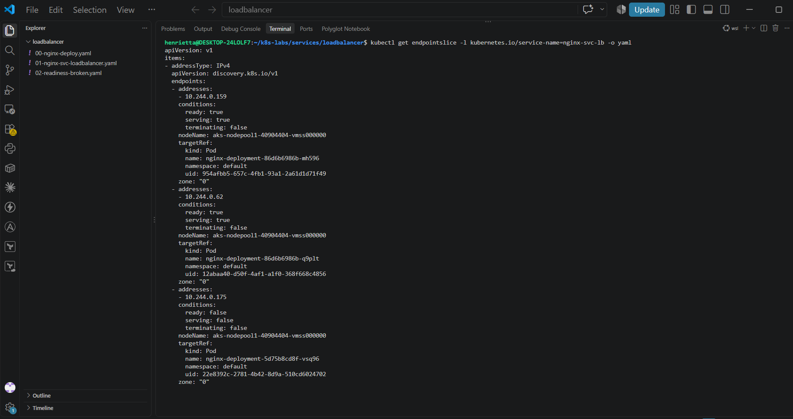

---

#### Screenshot 11 — Successful public curl response after recovery

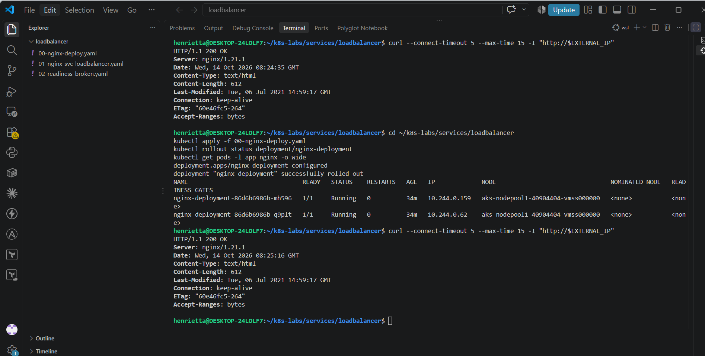

### Notes

**1. Why did the rollout not complete?**

Because the new pod introduced a broken readiness probe targeting /does-not-exist, the pod failed its health checks and never achieved a ready state, causing the rolling update to stall and time out.

**2. Why can the public endpoint still work while new Pods fail readiness?**

Because the existing healthy pods remain active and serving traffic (protected by maxUnavailable: 0), and unready pods are automatically excluded from the service's ready backend endpoints.

**3. What would happen if Kubernetes routed traffic to Pods before they were ready?**

Public clients would experience connection errors, intermittent 404s, or failed requests because traffic would hit containers that are still initializing or failing their internal health checks.

**4. How did you restore the Deployment successfully?**

By reapplying the original healthy deployment manifest (00-nginx-deploy.yaml), which replaced the broken readiness probe with the correct path (/), allowing the new pods to pass checks, become ready, and complete the rollout.

---

# Task 6 — Scale the Deployment Behind the Load Balancer

## Goal

Scale the NGINX Deployment and confirm that more ready Pods become available behind the same public endpoint.

### Evidence

#### Screenshot 12 — Two ready NGINX Pods verified initially; four ready Pods verified after scaling

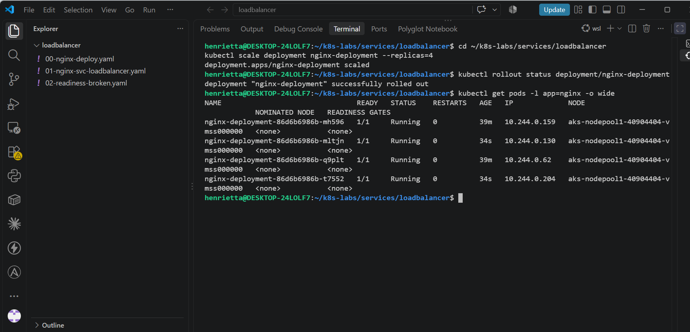

---

#### Screenshot 13 — Successful public curl response after scaling

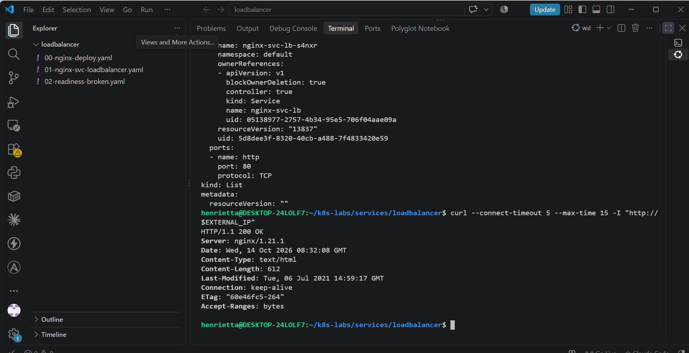

### Notes

**1. What changed after scaling the Deployment from two to four replicas?**

The ReplicaSet created two additional NGINX pods, and the EndpointSlice controller automatically updated the service endpoints to include all four ready pod IPs.

**2. Did the public IP change after scaling? Explain why or why not.**

No, the public IP remained exactly the same because the LoadBalancer Service maintains a stable external frontend IP while dynamically managing backend pod additions or removals.

**3. Why does scaling behind a LoadBalancer Service not require users to change the URL or IP they use?**

Because the LoadBalancer Service abstracts away all internal pod IPs and node routing, exposing a single stable virtual/public IP address to external users regardless of how many backend pods are added or removed.

---

# Task 7 — Share Your LoadBalancer Lab on LinkedIn

## Goal

Share what you learned about exposing an NGINX application publicly through a LoadBalancer Service on AKS.

### Evidence

#### Screenshot 14 — Published LinkedIn post about your LoadBalancer lab on AKS

Add your screenshot here.

#### LinkedIn post link

Add your link here.

---

# Submission Instructions

- Include the completed YAML files:
  - `00-nginx-deploy.yaml`
  - `01-nginx-svc-loadbalancer.yaml`
  - `02-readiness-broken.yaml`
- Add all required screenshots, numbered 1–14, under their corresponding Evidence sections.
- Use clear, readable screenshots showing the relevant commands, configuration, and outputs.
- Ensure your full name is visible in the required screenshots.
- Complete the Notes for Tasks 1–6 in your own words.
- Capture all required evidence before cleaning up Azure resources.
- Plan or complete Azure cleanup according to your lab ownership and reuse arrangements.
- Do not expose passwords, tokens, private keys, cluster credentials, kubeconfig contents, subscription IDs, account IDs, or infrastructure details you are not permitted to share.

---

# Completion Checklist

- [ ] Created or connected to an approved AKS lab cluster
- [ ] Confirmed ready AKS node(s) (Screenshot 1)
- [ ] Created and entered the LoadBalancer lab directory (Screenshot 2)
- [ ] Created the NGINX Deployment manifest (Screenshot 3)
- [ ] Verified successful rollout and two ready NGINX Pods initially (Screenshot 4)
- [ ] Created the LoadBalancer Service manifest (Screenshot 5)
- [ ] Verified the assigned external IP (Screenshot 6)
- [ ] Verified successful public access using curl (Screenshot 7)
- [ ] Created the broken readiness patch (Screenshot 8)
- [ ] Observed the expected incomplete rollout or readiness failure (Screenshot 9)
- [ ] Inspected EndpointSlices during the readiness failure (Screenshot 10)
- [ ] Restored the healthy Deployment and verified public access (Screenshot 11)
- [ ] Scaled the Deployment to four ready Pods and verified updated Service backends (Screenshot 12)
- [ ] Verified public access after scaling (Screenshot 13)
- [ ] Completed the Notes for Tasks 1–6
- [ ] Published the LinkedIn post (Screenshot 14)
- [ ] Included all required YAML files and screenshots
- [ ] Planned or completed Azure cleanup
- [ ] No sensitive data exposed

---

## 📌 About DMI & CloudAdvisory

DevOps Micro Internship (DMI) is a project-based DevOps program run by Pravin Mishra (The CloudAdvisory) focused on real-world execution, systems thinking, and career readiness.

It helps learners build strong DevOps foundations with hands-on experience.

---

## 📌 Resources

- 🌐 DMI Official Website: https://dmi.pravinmishra.com?utm_source=github&utm_medium=readme  
- 🎓 University: https://university.pravinmishra.com?utm_source=github&utm_medium=readme  
- 💬 Discord Community: https://discord.pravinmishra.com?utm_source=github&utm_medium=readme  
- 📝 Blog: https://dmi.pravinmishra.com/blog?utm_source=github&utm_medium=readme  
- ▶️ YouTube Playlist: https://www.youtube.com/playlist?list=PLFeSNDtI4Cho  
- 🔗 Pravin Mishra (LinkedIn): https://www.linkedin.com/in/pravin-mishra-aws-trainer/  
- 🏢 CloudAdvisory (LinkedIn): https://www.linkedin.com/company/thecloudadvisory/

---

*This submission is part of DevOps Micro Internship (DMI) — Agentic AI Track.*
