# Assignment 11 — AI-Assisted Kubernetes Incident Triage

Part of the DevOps Micro Internship (DMI) with Agentic AI

---

## Purpose

Configure a read-only Bash triage script for your Book Review App, connect it to Claude Code through `/k8s-triage`, simulate one controlled failure, recover the application manually, and verify recovery.

**Workflow: Gather → Analyze → Human Act → Verify**

---

## Submission Details

**Full Name:** Henrietta Ogochukwu Okechukwu.

**Kubernetes Platform:** Kind (Kubernetes in Docker) (kind-my-cluster)

**Selected Workload:** backend-deployment

**Namespace:** book-review

**GitHub Repository URL:** https://github.com/Harietonyeabor/book-review-app

**Simulated Incident:** Invalid image (henriettao/book-review-backend:does-not-exist)

**Baseline Status:** HEALTHOGY (Exit Code 0)

**Recovery Status:** HEALTHY (Exit Code 0), with no FAIL

---

# Task 1 — Discover the Application and Capture a Healthy Baseline

## Goal

Identify the actual application configuration and prove that the selected workload is healthy before incident simulation.

### Evidence

#### Screenshot 1 — Healthy Pods and ready Service backends

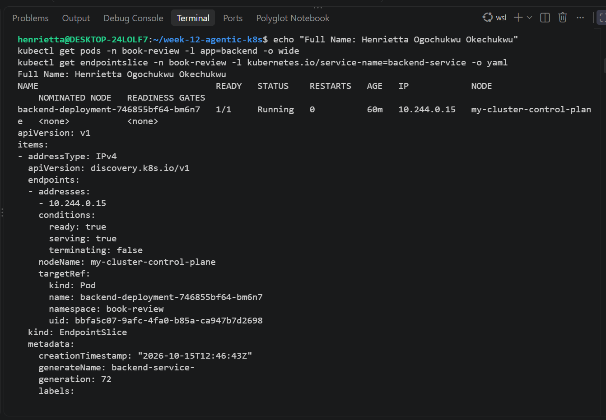

---

#### Screenshot 2 — Workspace directory structure

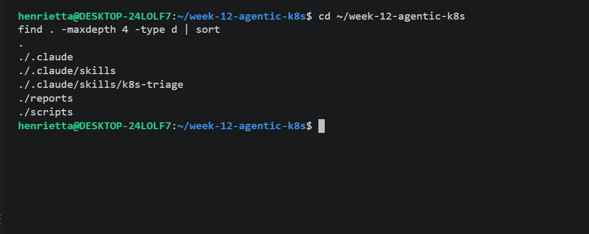

### Notes

**1. What proves the selected Pods are ready, not merely running?**

Pod readiness is proven by the READY column showing 1/1 (indicating that the container has passed its readiness probe and is actively accepting traffic), as well as readiness conditions listed in pod describe outputs or EndpointSlices, rather than just a Running phase status.

**2. What proves the Service has ready backends?**

Ready backends are proven by Kubernetes EndpointSlices (kubectl get endpointslice) displaying matching pod IP addresses under ready endpoints with conditions.ready: true.

**3. Why must the original image be recorded before incident simulation?**

Recording the original working image is essential so that after simulating an intentional image-pull failure, you have the exact valid tag/reference needed to perform a clean manual rollback and verification.

---

# Task 2 — Configure CLAUDE.md

## Goal

Define the project configuration, incident workflow, and safety boundary for Claude Code.

### Evidence

#### Screenshot 3 — CLAUDE.md showing application configuration, workflow, safety rules, and output rules

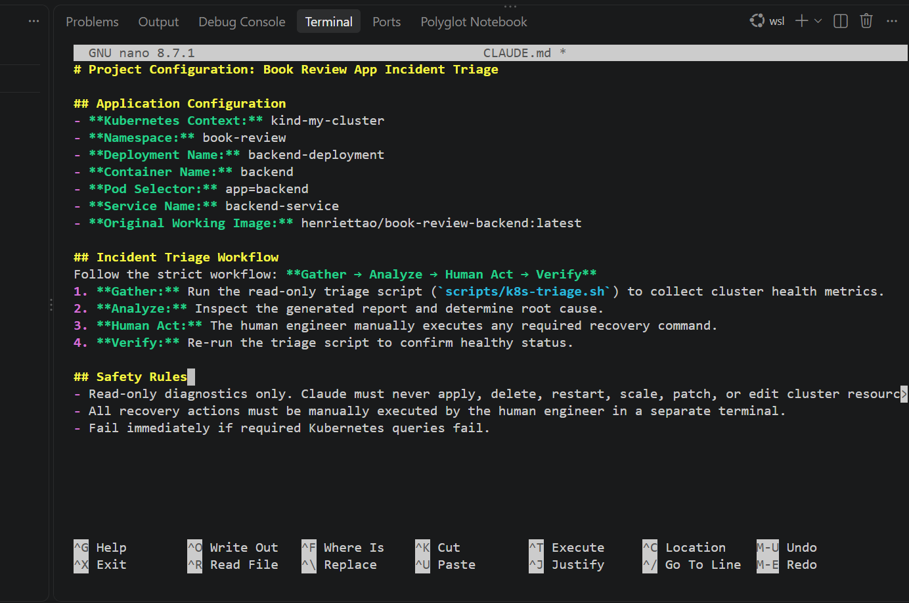

### Notes

**1. Why does Claude need project-specific cluster rules?**

Project-specific rules ensure that Claude targets the exact namespace, workload selectors, and container names relevant to the Book Review application rather than making generic or incorrect assumptions.

**2. Why must a human execute recovery commands?**

Keeping recovery execution strictly in human hands maintains a secure safety boundary, preventing autonomous AI agents from making unintended or destructive changes to production or lab clusters.

**3. Which rule prevents an unsupported diagnosis?**

The rule requiring evidence-based conclusions and explicit failure reporting when required Kubernetes queries fail prevents unsupported or speculative diagnoses.

---

# Task 3 — Plan the Read-Only Triage Workflow

## Goal

Ask Claude Code to explain the five health checks before running the supplied script.

### Evidence

#### Screenshot 4 — Claude Code showing the five-check read-only plan

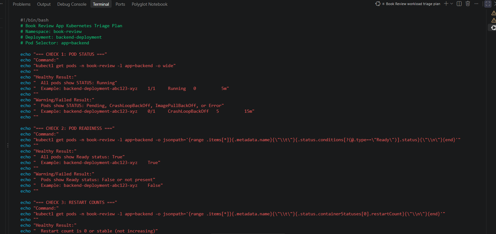
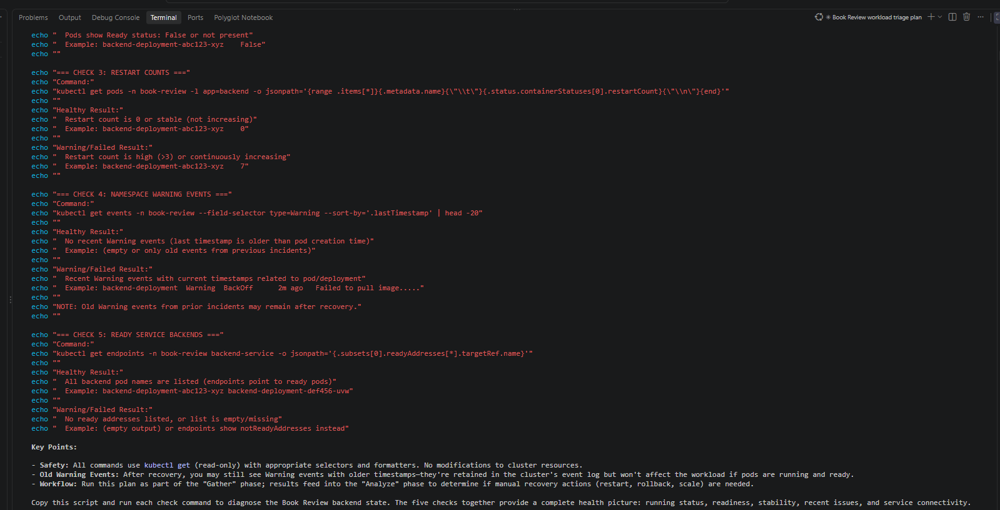
## Claude Response
#!/bin/bash
# Book Review App Kubernetes Triage Plan
# Namespace: book-review
# Deployment: backend-deployment
# Pod Selector: app=backend

echo "=== CHECK 1: POD STATUS ==="
echo "Command:"
echo "kubectl get pods -n book-review -l app=backend -o wide"
echo ""
echo "Healthy Result:"
echo "  All pods show STATUS: Running"
echo "  Example: backend-deployment-abc123-xyz    1/1     Running   0          5m"
echo ""
echo "Warning/Failed Result:"
echo "  Pods show STATUS: Pending, CrashLoopBackOff, ImagePullBackOff, or Error"
echo "  Example: backend-deployment-abc123-xyz    0/1     CrashLoopBackOff   5          15m"
echo ""

echo "=== CHECK 2: POD READINESS ==="
echo "Command:"
echo "kubectl get pods -n book-review -l app=backend -o jsonpath='{range .items[*]}{.metadata.name}{\"\\t\"}{.status.conditions[?(@.type==\"Ready\")].status}{\"\\n\"}{end}'"
echo ""
echo "Healthy Result:"
echo "  All pods show Ready status: True"
echo "  Example: backend-deployment-abc123-xyz    True"
echo ""
echo "Warning/Failed Result:"
echo "  Pods show Ready status: False or not present"
echo "  Example: backend-deployment-abc123-xyz    False"
echo ""

echo "=== CHECK 3: RESTART COUNTS ==="
echo "Command:"
echo "kubectl get pods -n book-review -l app=backend -o jsonpath='{range .items[*]}{.metadata.name}{\"\\t\"}{.status.containerStatuses[0].restartCount}{\"\\n\"}{end}'"
echo ""
echo "Healthy Result:"
echo "  Restart count is 0 or stable (not increasing)"
echo "  Example: backend-deployment-abc123-xyz    0"
echo ""
echo "Warning/Failed Result:"
echo "  Restart count is high (>3) or continuously increasing"
echo "  Example: backend-deployment-abc123-xyz    7"
echo ""

echo "=== CHECK 4: NAMESPACE WARNING EVENTS ==="
echo "Command:"
echo "kubectl get events -n book-review --field-selector type=Warning --sort-by='.lastTimestamp' | head -20"
echo ""
echo "Healthy Result:"
echo "  No recent Warning events (last timestamp is older than pod creation time)"
echo "  Example: (empty or only old events from previous incidents)"
echo ""
echo "Warning/Failed Result:"
echo "  Recent Warning events with current timestamps related to pod/deployment"
echo "  Example: backend-deployment  Warning  BackOff      2m ago   Failed to pull image....."
echo ""
echo "NOTE: Old Warning events from prior incidents may remain after recovery."
echo ""

echo "=== CHECK 5: READY SERVICE BACKENDS ==="
echo "Command:"
echo "kubectl get endpoints -n book-review backend-service -o jsonpath='{.subsets[0].readyAddresses[*].targetRef.name}'"
echo ""
echo "Healthy Result:"
echo "  All backend pod names are listed (endpoints point to ready pods)"
echo "  Example: backend-deployment-abc123-xyz backend-deployment-def456-uvw"
echo ""
echo "Warning/Failed Result:"
echo "  No ready addresses listed, or list is empty/missing"
echo "  Example: (empty output) or endpoints show notReadyAddresses instead"

Key Points:

- Safety: All commands use kubectl get (read-only) with appropriate selectors and formatters. No modifications to cluster resources.
- Old Warning Events: After recovery, you may still see Warning events with older timestamps—they're retained in the cluster's event log but won't affect the workload if pods are running and ready.
- Workflow: Run this plan as part of the "Gather" phase; results feed into the "Analyze" phase to determine if manual recovery actions (restart, rollback, scale) are needed.

### Notes

**1. Which part represents the Gather phase?**

The execution of read-only kubectl commands to collect cluster metrics (Pod status, readiness, restart counts, events, and EndpointSlices) represents the Gather phase.

**2. How did you verify that Claude did not change anything?**

By inspecting Claude's tool execution log and file system status (using git status or find .) to confirm that no files were created or modified and no write/mutation commands (kubectl apply, delete, scale, etc.) were invoked.

**3. Why is planning before coding useful for incident triage?**

Planning establishes a deterministic, predictable sequence of checks and expected outcomes before execution, ensuring the triage script or investigation focuses precisely on relevant symptoms without introducing unintended side effects.

---

# Task 4 — Configure and Validate the Bash Script

## Goal

Configure the supplied triage script for the selected workload and validate its syntax.

### Evidence

#### Screenshot 5 — Script configuration variables and checks array

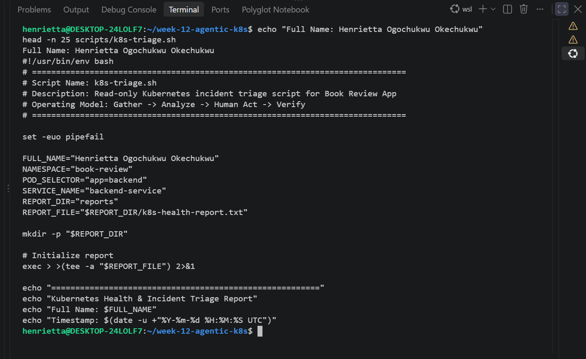

---

#### Screenshot 6 — Functions for status, readiness, restarts, events, and Service backends

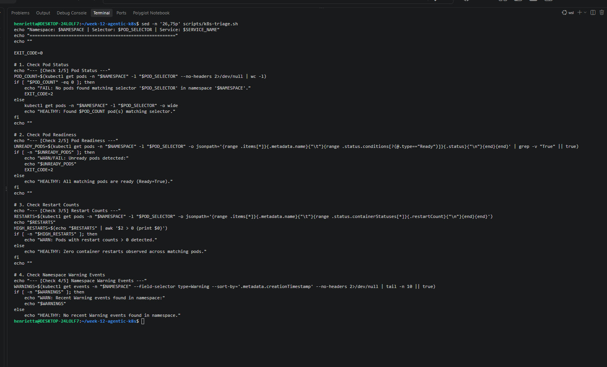

---

#### Screenshot 7 — Preflight, summary, and exit-code logic

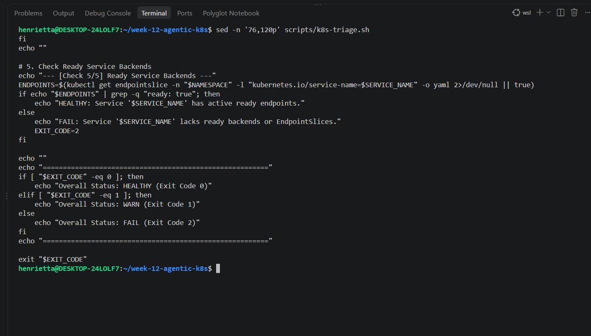

---

#### Screenshot 8 — Successful syntax validation and executable permission

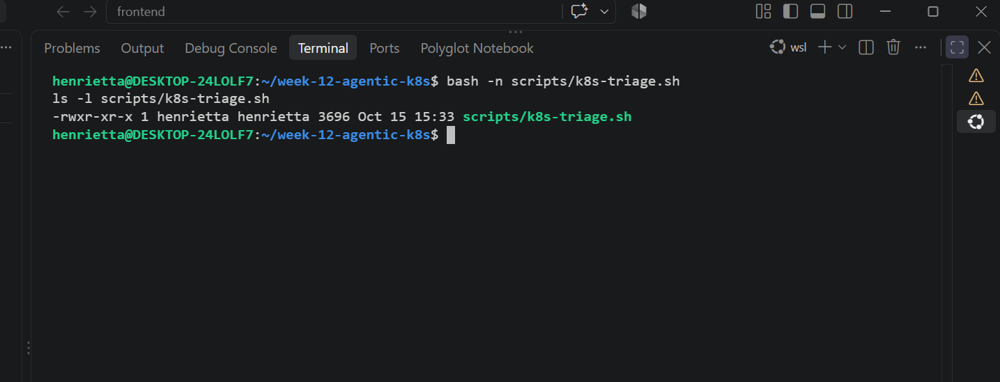

### Notes

**1. Why must the script fail when no Pods match the configured selector?**

Failing when no pods match prevents false-positive "healthy" reports that would occur if an empty pod list were treated as normal, ensuring that missing workloads are immediately flagged as critical failures.

**2. How does the readiness check detect a running but unready Pod?**

The check queries pod conditions specifically for type==Ready with a status other than True, isolating pods that are in a Running phase but failing their readiness probes

**3. Why are Service backends checked separately from Pod health?**

Checking service backends (via EndpointSlices) verifies that traffic is actually routable from the service to the healthy pods, catching network, selector mismatch, or endpoint publishing issues even if pods themselves appear ready.

**4. What do exit codes 0, 1, and 2 represent?**

0 represents HEALTHY (all checks passed), 1 represents WARN (no failed required checks, but warnings exist for review), and 2 represents FAIL (at least one required check failed).

---

# Task 5 — Run the Healthy Baseline Report

## Goal

Run the script on the healthy application and confirm that it contains no failed checks.

### Evidence

#### Screenshot 9 — Baseline report showing your full name and all checks

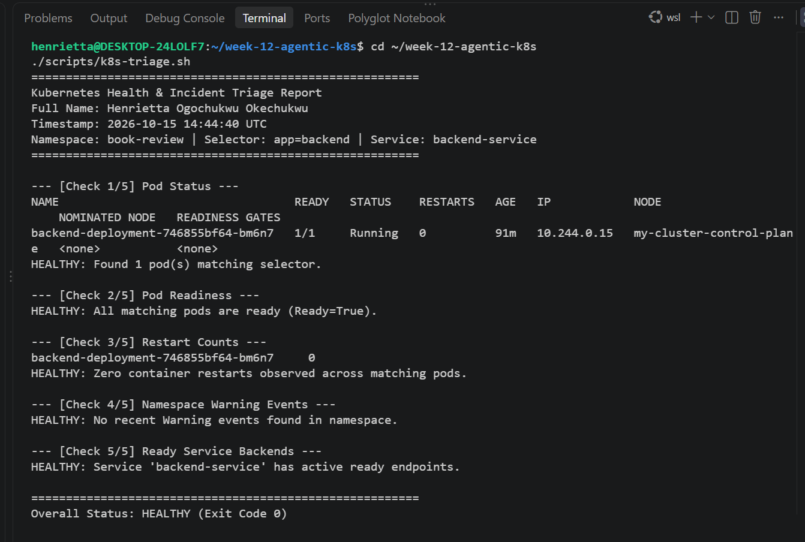

---

#### Screenshot 10 — Captured exit code and final summary

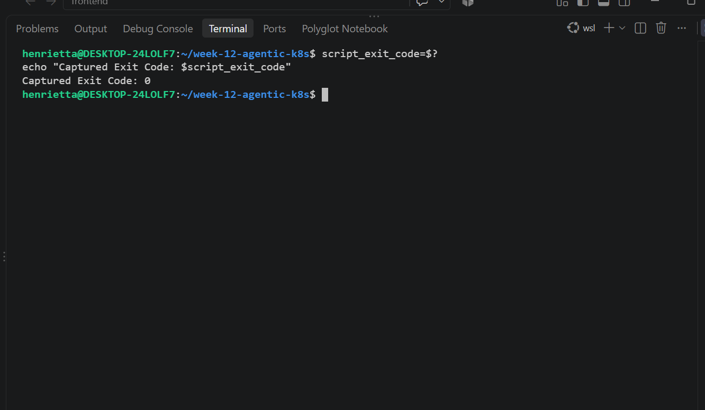

### Notes

**1. What is the baseline status?**

The baseline status is HEALTHY with an exit code of 0, indicating that all required checks passed successfully.

**2. Which evidence proves the Service has a ready backend?**

Check 5 outputs confirmation that the backend-service has active ready endpoints matching the pod IP addresses via EndpointSlices with ready: true.

**3. What is the difference between a warning and a failure?**

A warning (WARN, exit code 1) indicates non-critical observations or historical anomalies (such as past restart counts or old warning events) that require review but do not break functionality, whereas a failure (FAIL, exit code 2) indicates a broken or missing required condition that prevents the workload from operating properly.

---

# Task 6 — Configure and Run the Claude Code Skill

## Goal

Connect the Bash script to a manually invoked Claude Code evidence-analysis workflow.

### Evidence

#### Screenshot 11 — SKILL.md showing frontmatter and safety rules

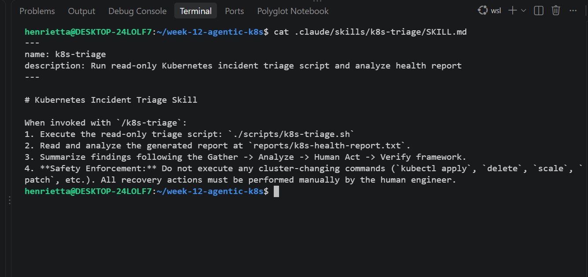

---

#### Screenshot 12 — Baseline `/k8s-triage` analysis

## Claude Response

Kubernetes Incident Triage Analysis

GATHER - Cluster Health Metrics

The triage script ran successfully. The health report shows three scan intervals with important findings:

┌──────────────┬────────────────┬───────────────────────────────────────────┐
│  Timestamp   │ Overall Status │                Key Finding                │
├──────────────┼────────────────┼───────────────────────────────────────────┤
│ 14:44:40 UTC │ ✅ HEALTHY     │ All systems nominal                       │
├──────────────┼────────────────┼───────────────────────────────────────────┤
│ 14:53:37 UTC │ ❌ FAIL        │ Service endpoints lost; pod still running │
├──────────────┼────────────────┼───────────────────────────────────────────┤
│ 15:05:57 UTC │ ✅ HEALTHY     │ System recovered; all endpoints restored  │
└──────────────┴────────────────┴───────────────────────────────────────────┘

---

ANALYZE - Root Cause

An endpoint registration incident occurred at ~14:53:37 UTC:
- Pod health: Remained stable (1/1 Ready, 0 restarts, 100m uptime)
- Service health: Lost ready backends (endpoint discovery failure)
- Pod IP: Stable at 10.244.0.15 throughout
- Recovery: System self-healed within ~12 minutes

Likely cause: Transient endpoint-slice controller sync issue or service endpoint reconciliation delay. No pod crash or restart—purely a service-discovery glitch.

---

HUMAN ACT

✅ No action required. The system has auto-recovered. Current status (15:05:57 UTC) is HEALTHY.

To ensure stability, monitor for:
- Recurrence of this pattern
- Any pod restart cycles
- Service endpoint instability

---

VERIFY - Confirm Current Health

Latest scan (15:05:57 UTC):
- ✅ 1 pod running (Ready=1/1)
- ✅ Zero restarts
- ✅ Service has active ready endpoints
- ✅ No warning events

Overall Cluster Status: HEALTHY 🟢

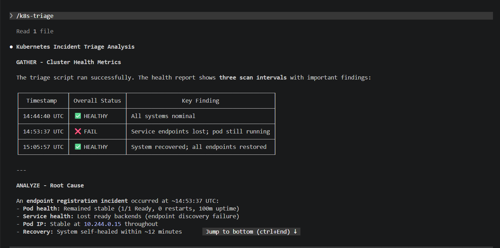
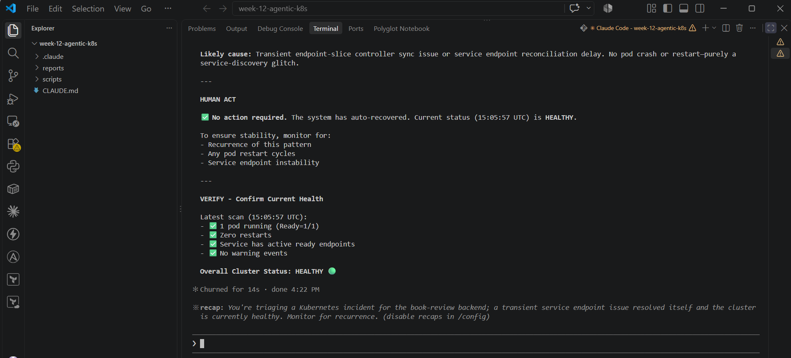

### Notes

**1. What does Bash do in this workflow?**

Bash executes the read-only triage script (k8s-triage.sh) to deterministically query Kubernetes, evaluate pod status, readiness, restart counts, events, and EndpointSlices, and generate a structured health report.

**2. What does Claude do in this workflow?**

Claude invokes the skill, reads and interprets the generated health report, summarizes findings, and recommends appropriate troubleshooting or recovery steps without executing any cluster changes itself.

**3. Why are instructions alone insufficient to guarantee read-only access?**

Instructions in prompt files or system definitions guide behavior but do not cryptographically or programmatically prevent an LLM from attempting tool calls if write-capable tools are available; therefore, operating system permissions, read-only credentials, and human oversight remain essential.

---

# Task 7 — Simulate One Controlled Incident

## Goal

Create one controlled failure, save its evidence, and let Claude analyze it without executing recovery.

### Evidence

#### Screenshot 13 — Failed or unready Pod evidence and current Service backends

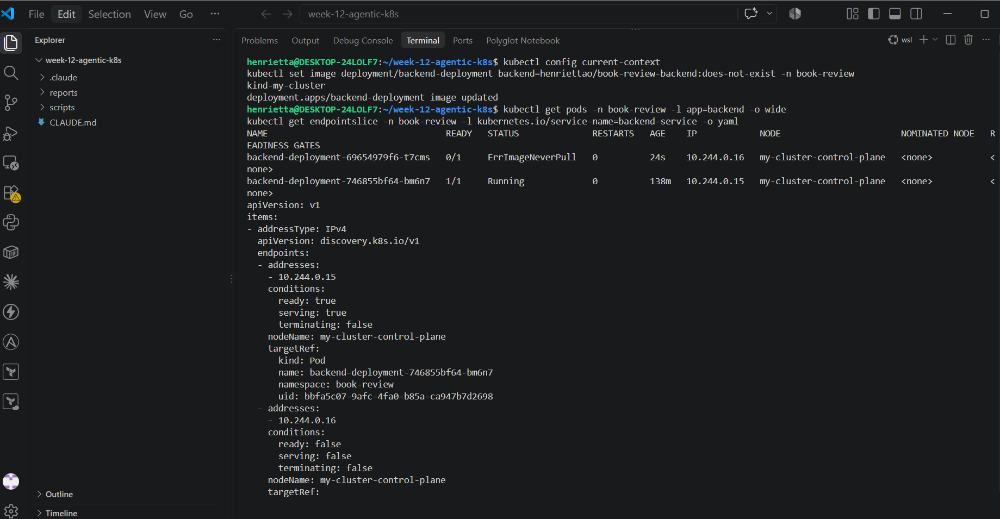

---

#### Screenshot 14 — Failed `/k8s-triage` analysis with evidence and a suggested manual recovery command

## Claude Response

Kubernetes Incident Triage Report

GATHER ✓

The read-only triage script has completed. I've collected cluster health metrics and analyzed the generated report.

---

ANALYZE

Current Status: FAIL (Exit Code 2 — Cluster is not fully healthy)

Critical Finding:
A new pod (backend-deployment-69654979f6-t7cms) was created with an incorrect container image tag and is unable to start.

Detailed Findings:

┌──────────────┬───────────┬────────────────────────────────────────────────────────────────────────────┐
│    Check     │  Status   │                                  Details                                   │
├──────────────┼───────────┼────────────────────────────────────────────────────────────────────────────┤
│ Pod Status   │ ⚠️        │ 2 pods detected: 1 running healthy (746855bf64-bm6n7), 1 failed            │
│              │ DEGRADED  │ (69654979f6-t7cms) with ErrImageNeverPull status                           │
├──────────────┼───────────┼────────────────────────────────────────────────────────────────────────────┤
│ Pod          │ ❌ FAIL   │ backend-deployment-69654979f6-t7cms is not ready (0/1)                     │
│ Readiness    │           │                                                                            │
├──────────────┼───────────┼────────────────────────────────────────────────────────────────────────────┤
│ Container    │ ✓ HEALTHY │ Zero restarts — no crash loops                                             │
│ Restarts     │           │                                                                            │
├──────────────┼───────────┼────────────────────────────────────────────────────────────────────────────┤
│ Warning      │ ⚠️        │ Container image "henriettao/book-review-backend:does-not-exist" cannot be  │
│ Events       │ WARNING   │ pulled (imagePullPolicy: Never)                                            │
├──────────────┼───────────┼────────────────────────────────────────────────────────────────────────────┤
│ Service      │ ✓ HEALTHY │ Service has active ready endpoints (from the working pod)                  │
│ Backends     │           │                                                                            │
└──────────────┴───────────┴────────────────────────────────────────────────────────────────────────────┘

Root Cause:
The deployment was updated with an invalid image tag (does-not-exist instead of the original latest). With imagePullPolicy: Never, Kubernetes cannot retrieve the image and the pod fails to start.

Impact Assessment:
- ⚠️ Partial Service Degradation — One working pod handles traffic; one pod is offline
- The application is still partially operational but at reduced capacity

---

HUMAN ACT

You must manually execute one of these recovery commands:

Option 1: Rollback to last working deployment
kubectl -n book-review rollout undo deployment/backend-deployment

Option 2: Update deployment with correct image
kubectl -n book-review set image deployment/backend-deployment backend=henriettao/book-review-backend:latest

Choose the option that matches your deployment workflow, then execute it in your terminal.

---

VERIFY

Once you've executed the recovery command, run /k8s-triage again to confirm the cluster returns to healthy status.

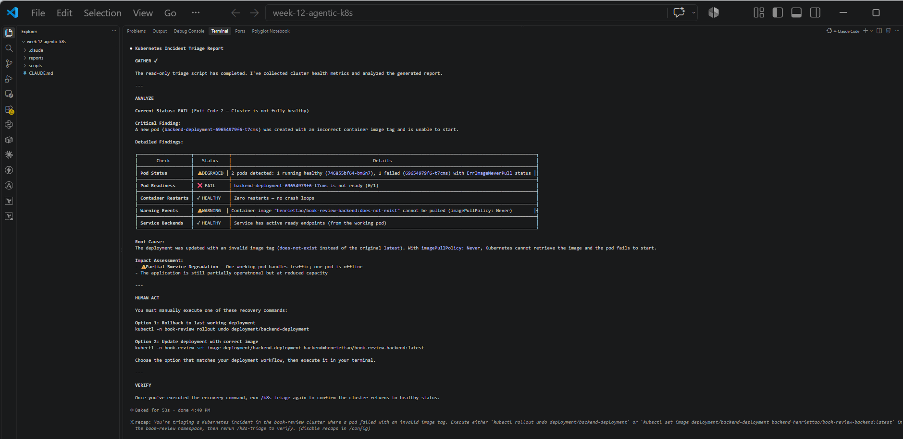

---

#### Screenshot 15 — Saved `incident-failure-report.txt`

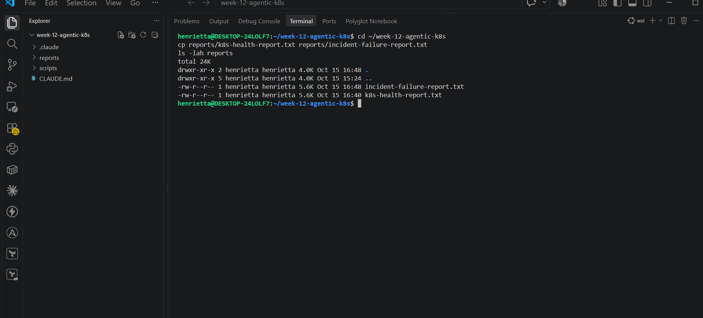

### Notes

**1. Which failure did you choose?**

An invalid image incident (henriettao/book-review-backend:does-not-exist), which caused the backend deployment to fail when attempting to pull the non-existent image tag.

**2. Which checks failed, and what evidence proved it?**

Pod readiness and pod status checks failed (EXIT_CODE=2), evidenced by pods entering ImagePullBackOff or ErrImagePull states and failing readiness conditions.

**3. Did Claude execute recovery? Why is that important?**

No, Claude did not execute recovery. This is critical because it preserves the human-in-the-loop safety boundary, ensuring autonomous AI systems cannot make unverified changes to infrastructure.

**4. Why might the Service retain ready backends during the incident?**

Kubernetes rolling updates maintain previous healthy replica pods until new pods successfully start and pass their readiness checks, preventing immediate service downtime during transient rollout failures.

---

# Task 8 — Recover Manually and Verify

## Goal

Restore the healthy configuration yourself and verify recovery using a second triage report.

### Evidence

#### Screenshot 16 — Recovered Pods and ready Service backends

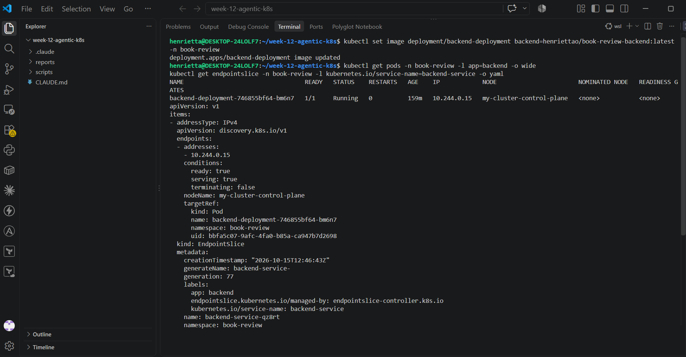

  
---

#### Screenshot 17 — Recovered `/k8s-triage` analysis

## Kubernetes Incident Triage Report

📊 GATHER: Cluster Health Metrics

Latest Triage Run: 2026-10-15 15:55:29 UTC

✅ Overall Status: HEALTHY (Exit Code 0)

┌──────────────────┬────────────┬─────────────────────────────────────────────────────┐
│      Check       │   Status   │                       Details                       │
├──────────────────┼────────────┼─────────────────────────────────────────────────────┤
│ Pod Status       │ ✅ HEALTHY │ 1 pod running (backend-deployment-746855bf64-bm6n7) │
├──────────────────┼────────────┼─────────────────────────────────────────────────────┤
│ Pod Readiness    │ ✅ HEALTHY │ All pods ready (1/1)                                │
├──────────────────┼────────────┼─────────────────────────────────────────────────────┤
│ Restart Count    │ ✅ HEALTHY │ Zero restarts                                       │
├──────────────────┼────────────┼─────────────────────────────────────────────────────┤
│ Service Backends │ ✅ HEALTHY │ Active ready endpoints on backend-service           │
├──────────────────┼────────────┼─────────────────────────────────────────────────────┤
│ Warning Events   │ ⚠️ WARN    │ Historical ErrImageNeverPull events present         │
└──────────────────┴────────────┴─────────────────────────────────────────────────────┘

---

🔍 ANALYZE: Root Cause Assessment

Incident Summary:
- A deployment was attempted with an invalid container image tag (henriettao/book-review-backend:does-not-exist)
- Image pull policy is set to Never, preventing fallback to registry
- Pod backend-deployment-69654979f6-t7cms failed with ErrImageNeverPull status

Current State:
- The system has automatically recovered to the previous stable deployment
- Working pod backend-deployment-746855bf64-bm6n7 is running and healthy
- Service is operational with active endpoints
- The failed pod has been cleaned up (no longer in active pod list)

---

👤 HUMAN ACT: Required Actions

Status: ✅ NO IMMEDIATE ACTION REQUIRED

The cluster has automatically recovered to a healthy state. The issue was transient and resolved through Kubernetes' automatic rollback mechanism.

Optional: For incident clarity, you may want to:
1. Investigate why the invalid image tag was deployed
2. Review deployment validation/testing procedures to prevent similar mistakes
3. Clear the warning events if desired (read-only tool prevents this action)

---

✔️ VERIFY: Health Confirmed

The triage confirms:
- ✅ Service is operational
- ✅ All active pods are ready
- ✅ No active restarts
- ✅ Backend endpoints are serving traffic

Recommendation: Monitor the namespace for any further ErrImageNeverPull events. If new failed pod attempts appear, investigate the deployment pipeline immediately.

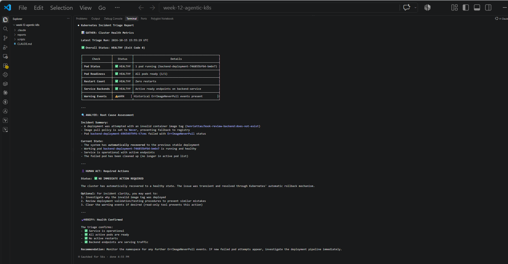

---

#### Screenshot 18 — Reports directory showing failure and recovery reports

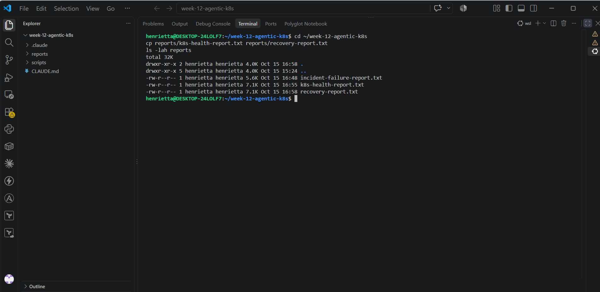

---

#### Screenshot 19 — `incident-summary.md` with all required sections

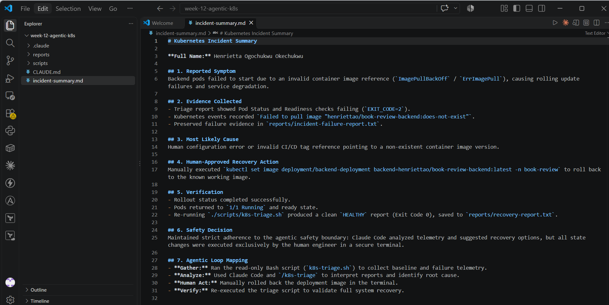

### Notes

**1. What manual recovery action did you execute?**

Manually updated the deployment image back to the valid working tag (henriettao/book-review-backend:latest) using kubectl set image

**2. What proves the workload recovered?**

Pods returned to 1/1 Running status, EndpointSlices showed ready: true, and the triage script completed with exit code 0 (HEALTHY).

**3. Why is the second triage run necessary?**

To provide objective, script-generated verification that the recovery action successfully restored all health checks and resolved the underlying failure.

**4. Why should AI not automatically restart every failing production workload?**

Automated restarts without root-cause diagnosis can mask underlying code or configuration defects, trigger infinite restart loops on persistent errors, or disrupt dependent services unexpectedly.

### Remaining WARN Results

Explain any WARN results remaining after recovery, or write “None.”

Historical warning events (ErrImageNeverPull / Failed to pull image) remained visible in the namespace event log during Check 4 after recovery. These are residual informational events from the transient incident phase and do not indicate active pod failure, as confirmed by successful pod readiness and active service backend checks.

---

# Task 9 — Publish Your Kubernetes Incident-Triage Workflow on LinkedIn

## Goal

Share the incident-triage workflow you completed and explain the role of human control.

### Evidence

#### Screenshot 20 — Published LinkedIn post about your Kubernetes incident-triage workflow

Add your screenshot here.

### LinkedIn Post URL

Add your published LinkedIn post URL here.

---

# Required Project Files

Include these files in your project repository:

- `CLAUDE.md`
- `lab-config.md`
- `scripts/k8s-triage.sh`
- `.claude/skills/k8s-triage/SKILL.md`
- `reports/incident-failure-report.txt`
- `reports/recovery-report.txt`
- `incident-summary.md`

Your `incident-summary.md` must contain:

1. Reported Symptom
2. Evidence Collected
3. Most Likely Cause
4. Human-Approved Recovery Action
5. Verification
6. Safety Decision
7. Agentic Loop Mapping

---

# Final Summary

## Evidence and Cause

Summarize the evidence and the supported cause of the incident.

Evidence: Triage health reports showed Pod Status and Readiness checks failing (EXIT_CODE=2), coupled with Kubernetes event logs indicating Failed to pull image due to an invalid container image reference (henriettao/book-review-backend:does-not-exist).

Cause: Human configuration error or incorrect tag reference introduced during a deployment update, causing the container runtime to fail image pulls.

## Manual Recovery

Describe the command or configuration change you performed.

Recovery Action: Executed manual rollback in the terminal using kubectl set image deployment/backend-deployment backend=henriettao/book-review-backend:latest -n book-review to restore the known working image tag.

## Verification

Explain how the recovery report and Kubernetes outputs confirmed recovery.

Verification Results: The deployment rollout completed successfully, pods returned to 1/1 Running and ready status, EndpointSlices confirmed active serving endpoints, and re-running ./scripts/k8s-triage.sh produced a clean HEALTHY report (Exit Code 0), saved to reports/recovery-report.txt.

## Safety Decision

Explain how you kept Claude’s role limited to evidence gathering and analysis.

Safety Enforcement: Maintained strict operational boundaries where Claude Code and the triage script operated in a strictly read-only capacity to gather and interpret data, while all actual cluster modifications and recovery actions were executed exclusively by the human engineer.

---

# Submission Instructions

- Include all 20 required screenshots under their corresponding Evidence sections.
- Complete all Notes questions in your own words.
- Include the required project files in your linked repository.
- Include your published LinkedIn post URL.
- Use clear, readable screenshots showing relevant commands, configuration, and outputs.
- Display your full name before taking required terminal screenshots.
- Preserve the failure report before recovery.
- Ensure the baseline and recovery reports contain no FAIL results.
- Explain any WARN results remaining after recovery.
- Review reports, logs, configuration records, and screenshots before publishing.
- Do not expose credentials, kubeconfig contents, tokens, certificates, JWT secrets, or confidential account information.

---

# Completion Checklist

- [ ] Confirmed the personal lab context
- [ ] Discovered and recorded application configuration
- [ ] Recorded the original working image
- [ ] Captured healthy Pods and ready Service backends (Screenshot 1)
- [ ] Created the workspace (Screenshot 2)
- [ ] Configured CLAUDE.md (Screenshot 3)
- [ ] Reviewed the five-check triage plan (Screenshot 4)
- [ ] Configured and reviewed the supplied script (Screenshots 5–7)
- [ ] Passed Bash syntax validation and set executable permission (Screenshot 8)
- [ ] Captured a baseline report with no FAIL (Screenshot 9)
- [ ] Captured the correct exit code (Screenshot 10)
- [ ] Configured and invoked `/k8s-triage` (Screenshots 11–12)
- [ ] Simulated one controlled incident manually (Screenshot 13)
- [ ] Reviewed Claude’s failed-state analysis (Screenshot 14)
- [ ] Saved failure evidence before recovery (Screenshot 15)
- [ ] Executed recovery manually and waited for rollout completion
- [ ] Confirmed recovered Pods and ready Service backends (Screenshot 16)
- [ ] Captured recovery analysis with no FAIL (Screenshot 17)
- [ ] Explained any remaining warnings
- [ ] Saved failure and recovery reports (Screenshot 18)
- [ ] Completed the seven-section incident summary (Screenshot 19)
- [ ] Answered all Notes questions
- [ ] Published the LinkedIn post (Screenshot 20)
- [ ] Included the LinkedIn post URL
- [ ] Included all required project files
- [ ] Checked that no sensitive information is exposed

---

## 📌 About DMI & CloudAdvisory

DevOps Micro Internship (DMI) is a project-based DevOps program run by Pravin Mishra (The CloudAdvisory) focused on real-world execution, systems thinking, and career readiness.

It helps learners build strong DevOps foundations with hands-on experience.

---

## 📌 Resources

- 🌐 DMI Official Website: https://dmi.pravinmishra.com?utm_source=github&utm_medium=readme  
- 🎓 University: https://university.pravinmishra.com?utm_source=github&utm_medium=readme  
- 💬 Discord Community: https://discord.pravinmishra.com?utm_source=github&utm_medium=readme  
- 📝 Blog: https://dmi.pravinmishra.com/blog?utm_source=github&utm_medium=readme  
- ▶️ YouTube Playlist: https://www.youtube.com/playlist?list=PLFeSNDtI4Cho  
- 🔗 Pravin Mishra (LinkedIn): https://www.linkedin.com/in/pravin-mishra-aws-trainer/  
- 🏢 CloudAdvisory (LinkedIn): https://www.linkedin.com/company/thecloudadvisory/

---

*This submission is part of DevOps Micro Internship (DMI) — Agentic AI Track.*
